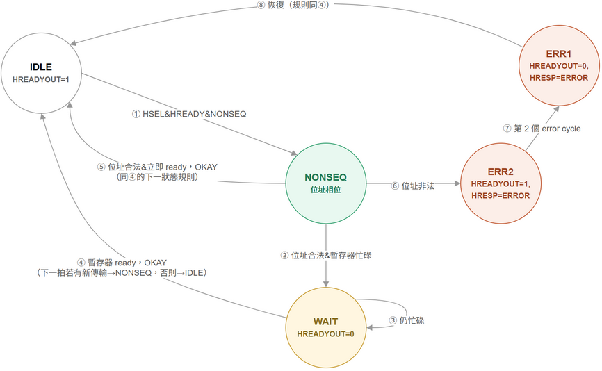
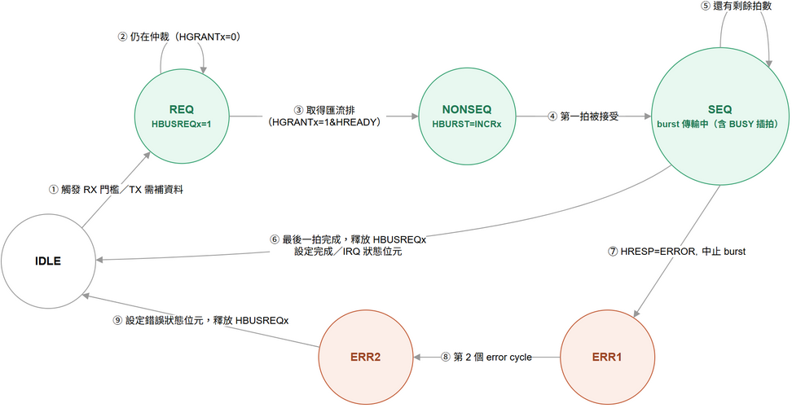
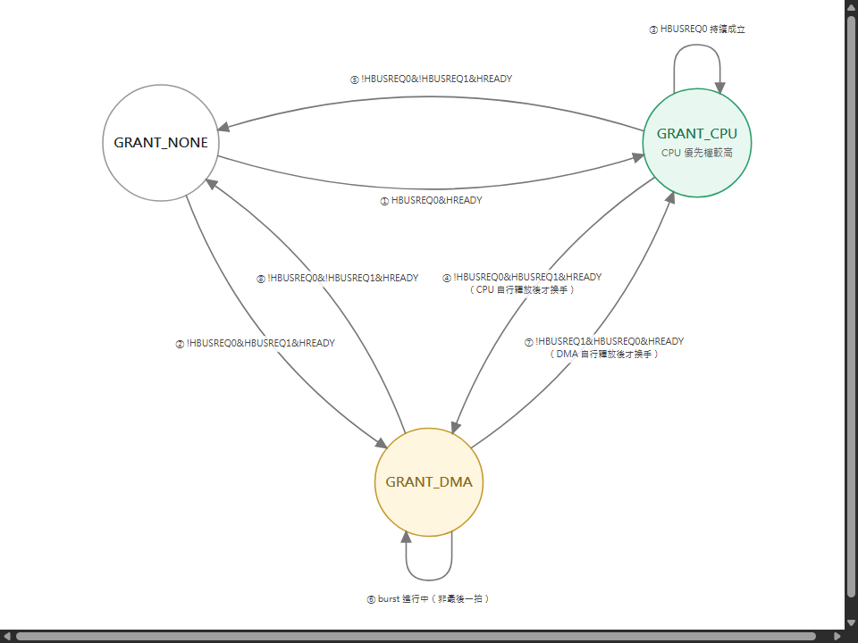

# AHB Master / Slave Wrapper FSM — UART SIP

選用的 IP（SIP）：一顆 UART core（暫存器配置比照EGO-XZ7 板子、Zynq-7000 PS 上常見的
UART ，內建 FIFO），把它包裝成掛在 AHB 匯流排上的模組。這顆 UART 有：

- 一組 **暫存器檔**（control、status、baud divisor、TX data、RX data）→ 以 **AHB slave** 的身份被存取。
- 內部的 **DMA 引擎**，負責把收到的 byte burst 寫回記憶體、以及把要傳送的 byte 從記憶體讀出，
  全程不需要 CPU 介入 → 當它取得匯流排控制權時，扮演 **AHB master**。

因為系統裡有多個 Master（CPU + UART 的 DMA）與多個 Slave（至少有記憶體控制器 + UART 暫存器
slave），中間需要一個 **arbiter（仲裁器）** 與 **address decoder（位址解碼器）**，這是 AHB
規格書裡多層/共享匯流排拓樸的標準做法。

<!--
## 系統拓樸

🔍 [看大圖](https://raw.githubusercontent.com/shj-F115112128/SOC_Practice/main/HW1/Upload/image/ahb_topology.drawio.png) ／
原始檔：[Upload/ahb_topology.drawio](../Upload/ahb_topology.drawio)
-->

## 1. AHB Slave Wrapper FSM（UART 暫存器檔）

負責控制 `HREADYOUT`/`HRESP`，並把 UART 的 control/status/TX/RX 暫存器開放給外部存取。狀態命名
沿用上課教的 AHB Subordinate FSM 命名：位址階段是 `NONSEQ`/`SEQ`，資料階段若暫存器還沒 ready
（例如讀取時 RX FIFO 是空的、或寫入時 TX FIFO 滿了）就插入 `WAIT`，非法存取則回應兩個 cycle 的
`ERROR`。

暫存器對照（offset 0x0～0xC，決定下面每個狀態的行為）：

| Offset | 暫存器 | 存取 | 行為 |
|---|---|---|---|
| 0x0 | CTRL | R/W | bit0 = enable |
| 0x4 | STATUS | RO | bit0 = tx_busy，bit1 = rx_ready |
| 0x8 | TXDATA | R/W | 寫入啟動一次模擬傳輸（忙碌 4 個 cycle）；忙碌中再寫入會造成 back-pressure |
| 0xC | RXDATA | RO | 讀取後清除 rx_ready |
| ≥0x10 | — | — | 非法位址 |

**五個狀態：**

- **IDLE**（`HREADYOUT=1`）：沒有傳輸在進行，隨時準備接受新的位址相位。
- **NONSEQ**（位址相位）：剛接受一筆傳輸的位址相位（`HSEL & HREADY & HTRANS=NONSEQ`），這一拍
  鎖存位址、解碼要存取哪個暫存器，同一拍就判斷暫存器是否 ready。
- **WAIT**（`HREADYOUT=0`）：位址合法，但暫存器還沒 ready——讀 RXDATA 時 `rx_ready` 還是 0，或
  寫 TXDATA 時 `tx_busy` 還是 1——用 `HREADYOUT=0` 插入等待拍，讓 Master 停在原地。
- **ERR1**（`HREADYOUT=0, HRESP=ERROR`）：位址非法（≥0x10）或是不合法的寫入，AHB 規定錯誤回應
  至少要撐兩個 cycle，這是第一個 cycle。
- **ERR2**（`HREADYOUT=1, HRESP=ERROR`）：錯誤回應的第二個 cycle，`HREADYOUT` 拉回 1 讓傳輸結
  束，FSM 緊接著可以接受下一筆正常傳輸。

🔍 [看大圖](https://raw.githubusercontent.com/shj-F115112128/SOC_Practice/main/HW1/Upload/image/ahb_slave_fsm.drawio.png) ／
原始檔：[Upload/ahb_slave_fsm.drawio](../Upload/ahb_slave_fsm.drawio)

**八個轉移：**

1. **IDLE → NONSEQ**：`HSEL & HREADY & HTRANS=NONSEQ`，偵測到新的有效傳輸。
2. **NONSEQ → WAIT**：位址合法，但暫存器忙碌（RX FIFO 空／TX FIFO 滿），需要插拍。
3. **WAIT 自迴圈**（仍忙碌）：暫存器還沒 ready，繼續停在 WAIT，`HREADYOUT` 維持 0。
4. **WAIT → IDLE**（暫存器 ready，OKAY）：暫存器轉為 ready，驅動 `HRDATA` 或鎖存 `HWDATA`，
   `HREADYOUT=1`；下一拍若緊接著有新傳輸則直接 pipeline 回 NONSEQ，否則回 IDLE。
5. **NONSEQ → IDLE**（位址合法且立即 ready，OKAY）：跟④同一組規則，只是暫存器剛好不需要等待，
   單一 cycle 就以 OKAY 完成。
6. **NONSEQ → ERR1**（位址非法）：位址落在 0x10 以上，或寫入不合法，進入兩段式錯誤回應的第一拍。
7. **ERR1 → ERR2**（第 2 個 error cycle）：固定走完第二個 `HRESP=ERROR` cycle，`HREADYOUT` 轉回 1。
8. **ERR2 → IDLE**（恢復，規則同④）：錯誤回應結束，FSM 恢復正常，後續存取不受影響；若下一拍
   緊接有效傳輸一樣可以 pipeline 回 NONSEQ。

對應 RTL：`rtl/ahb_uart_slave_wrapper.vhd`（`S_IDLE`/`S_NONSEQ`/`S_WAIT`/`S_ERR1`/`S_ERR2`，命名
與轉移順序與本圖一致）。

## 2. AHB Master Wrapper FSM（UART 內部 DMA）

由 UART 的 FIFO 門檻值觸發（RX 半滿 → burst 寫入記憶體；TX 低於門檻 → burst 從記憶體讀取），
不是 CPU 下指令觸發。在驅動任何位址階段之前，必須先向 arbiter 要求匯流排。

**六個狀態：**

- **IDLE**：沒有待處理的 DMA 需求，不持有匯流排。
- **REQ**（`HBUSREQx=1`）：FIFO 門檻觸發，assert `HBUSREQx` 向 arbiter 要匯流排，還沒拿到
  `HGRANTx` 前持續停在這裡。
- **NONSEQ**（`HBURST=INCRx`）：拿到 grant 之後驅動位址相位，`HTRANS=NONSEQ`、`HBURST` 設成
  要做的 incrementing burst 長度。
- **SEQ**（burst 傳輸中，含 BUSY 插拍）：burst 正式開始，`HTRANS=SEQ` 逐拍傳輸；如果 DMA 自己
  的 FIFO 還沒 ready，會插入 `HTRANS=BUSY` 延長一拍（這部分併在這個狀態的自迴圈裡，沒有另外畫
  一個 BUSY 狀態）。
- **ERR1**（第 1 個 error cycle）：burst 途中收到 `HRESP=ERROR`，中止這次 burst，進入兩段式錯誤
  回應。
- **ERR2**（第 2 個 error cycle）：錯誤回應第二拍，之後設定 UART 的錯誤狀態位元、釋放 `HBUSREQx`。

🔍 [看大圖](https://raw.githubusercontent.com/shj-F115112128/SOC_Practice/main/HW1/Upload/image/ahb_master_fsm.drawio.png) ／
原始檔：[Upload/ahb_master_fsm.drawio](../Upload/ahb_master_fsm.drawio)（SEQ 狀態的自迴圈已把
「FIFO 未 ready 時插入 BUSY 拍」併進去，不另外畫成一個狀態）

**九個轉移：**

1. **IDLE → REQ**：觸發 RX 門檻或 TX 需要補資料，assert `HBUSREQx`。
2. **REQ 自迴圈**（仍在仲裁）：`HGRANTx=0`，繼續等待仲裁結果。
3. **REQ → NONSEQ**（取得匯流排）：`HGRANTx=1 & HREADY`，驅動 `HADDR`、`HTRANS=NONSEQ`、
   `HBURST=INCRx`。
4. **NONSEQ → SEQ**（第一拍被接受）：`HREADY=1`，第一拍成功，後續轉 `HTRANS=SEQ`。
5. **SEQ 自迴圈**（還有剩餘拍數）：burst 還沒傳完；若 DMA FIFO 未 ready 則 `HTRANS=BUSY` 延長，
   位址保持不變。
6. **SEQ → IDLE**（最後一拍完成）：burst 傳完，釋放 `HBUSREQx`，設定 UART 完成／IRQ 狀態位元。
7. **SEQ → ERR1**（`HRESP=ERROR`，中止 burst）：傳輸途中收到錯誤回應，立刻停止 burst。
8. **ERR1 → ERR2**（第 2 個 error cycle）：固定走完第二個錯誤 cycle。
9. **ERR2 → IDLE**（設定錯誤狀態位元，釋放 `HBUSREQx`）：記錄這次 DMA 傳輸失敗，釋放匯流排請求，
   回到閒置。

對應 RTL：`rtl/ahb_uart_master_wrapper.vhd`，並且在 `sim/tb_ahb_system_msc.vhd` 系統層級測試裡
實際跑過 burst 寫入記憶體的完整路徑（細節見 [05-rtl-simulation.md](05-rtl-simulation.md)）。RTL
實際上多兩個狀態（`S_LAST`/`S_DONE`，把「burst 最後一拍」跟「設定完成旗標」拆成兩個 cycle）——
這張圖為了簡潔，把這兩個狀態收斂進上面的⑥號轉移（SEQ → IDLE）裡，是刻意選擇的抽象層級，不是
遺漏或跟 RTL 不符。

## 3. Arbiter FSM（支援多 Master）

因為 CPU 跟 UART-DMA 都可能是 Master，需要這個仲裁器決定目前匯流排給誰。採用最簡單的固定優先
權：CPU 優先權比 DMA 高（round-robin 可以直接替換這套邏輯，不影響其他 wrapper 的設計）。

**三個狀態：**

- **GRANT_NONE**：目前沒有任何 Master 持有匯流排。
- **GRANT_CPU**（CPU 優先權較高）：CPU 持有匯流排。
- **GRANT_DMA**：UART 的 DMA 持有匯流排。

🔍 [看大圖](https://raw.githubusercontent.com/shj-F115112128/SOC_Practice/main/HW1/Upload/image/ahb_arbiter_fsm.drawio.png) ／
原始檔：[Upload/ahb_arbiter_fsm.drawio](../Upload/ahb_arbiter_fsm.drawio)

**八個轉移：**

1. **GRANT_NONE → GRANT_CPU**：`HBUSREQ0 & HREADY`，CPU 提出請求。
2. **GRANT_NONE → GRANT_DMA**：`!HBUSREQ0 & HBUSREQ1 & HREADY`，只有 DMA 提出請求。
3. **GRANT_CPU 自迴圈**（`HBUSREQ0` 持續成立）：即使 DMA 同時在請求，CPU 優先權較高，持續保持
   grant。
4. **GRANT_CPU → GRANT_DMA**：`!HBUSREQ0 & HBUSREQ1 & HREADY` 且到達 burst 邊界：CPU 放開請求，
   DMA 在下一個安全點被接手。
5. **GRANT_CPU → GRANT_NONE**：`!HBUSREQ0 & !HBUSREQ1 & HREADY`，兩邊都沒有請求了。
6. **GRANT_DMA 自迴圈**（burst 進行中，非最後一拍）：DMA 的 burst 還沒走到邊界，不可以被插隊。
7. **GRANT_DMA → GRANT_CPU**：`HBUSREQ0 & HREADY` 且到達 burst 邊界：CPU 請求出現，在 DMA 這筆
   burst 結束的安全點換手。
8. **GRANT_DMA → GRANT_NONE**：`!HBUSREQ0 & !HBUSREQ1 & HREADY`，兩邊都沒有請求了。

**關鍵規則：** grant 只能在傳輸邊界切換，也就是 `HREADY=1` 且不在 `SEQ` burst 中途（`HBURST`/
`HTRANS` 顯示最後一拍，或該 Master 自己解除請求），這樣才不會把一個正在進行中的 burst 傳輸腰
斬——這是 AHB 規格書對仲裁時機的硬性要求，不是設計選擇。對應 RTL：`rtl/ahb_arbiter.vhd`（固定
優先權、非搶佔式，兩個方向的 grant 切換都要求「目前持有者自己先解除 `HBUSREQ`」才會換手）。

## 多 Slave 補充說明

Decoder 會把 `HADDR` 範圍對應到各個 `HSELx`；每顆 SIP 真正不同的只有上面這個模組（UART slave
wrapper）— 記憶體控制器 slave、以及 decoder/mux-back 邏輯都是標準 AHB 基礎架構，這裡就不重複
畫出。
