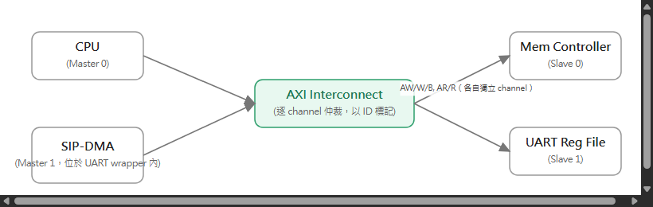
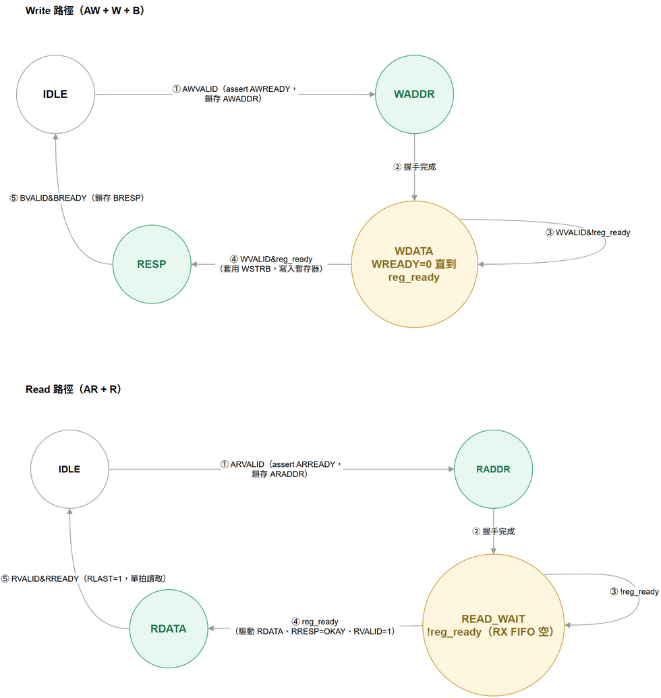
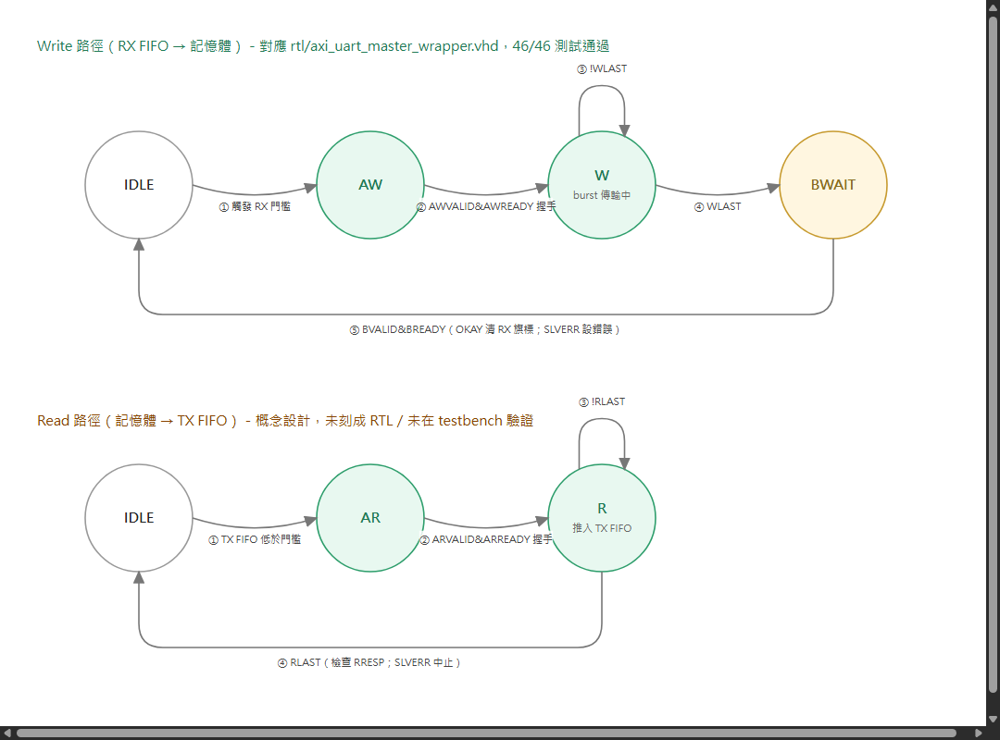

# AXI Master / Slave Wrapper FSM — UART SIP

跟 AHB 版本相同的 UART SIP（見 [01-ahb-wrapper-fsm.md](01-ahb-wrapper-fsm.md)），這次改包裝在
AXI 上。跟 AHB 單一共享的位址/資料匯流排不同，AXI 有 5 個獨立的 channel（AW、W、B、AR、R），
所以 wrapper 自然會拆成 master 端與 slave 端各自獨立的 **write FSM** 和 **read FSM** — 它們可以
並行運作。

<!--
## 系統拓樸

🔍 [看大圖](https://raw.githubusercontent.com/shj-F115112128/SOC_Practice/main/HW1/Upload/image/axi_topology.drawio.png) ／
原始檔：[Upload/axi_topology.drawio](../Upload/axi_topology.drawio)
-->

## 1. AXI Slave Wrapper FSM（UART 暫存器檔）

暫存器檔跟 [01-ahb-wrapper-fsm.md](01-ahb-wrapper-fsm.md) 完全相同，只是這次用 AXI 包裝。因為
AXI 的 write（AW/W/B）跟 read（AR/R）channel 本來就是獨立的，這張圖把兩條 channel FSM 畫在同一
張圖裡，分成上下兩排。

**Write 路徑（AW + W + B）— 四個狀態：**

- **IDLE**：等待寫入請求。
- **WADDR**：收到 `AWVALID`，assert `AWREADY`，鎖存 `AWADDR`。
- **WDATA**（`WREADY=0` 直到 `reg_ready`）：等 `WVALID`；如果暫存器還沒 ready（例如 TX FIFO
  滿），就讓 `WREADY=0` 形成 back-pressure，這是 AXI 版等效於 AHB 版 `WAIT` 狀態的地方。
- **RESP**：套用 `WSTRB` byte lane 寫入暫存器後，鎖存 `BRESP`（位址合法為 OKAY，否則
  SLVERR），等 `BREADY` 握手完成回 IDLE。

Write 路徑轉移：① `AWVALID` → ② 握手完成 → ③ `WVALID & !reg_ready`（自迴圈，back-pressure）
→ ④ `WVALID & reg_ready`（真正寫入）→ ⑤ `BVALID & BREADY`（鎖存 BRESP，回 IDLE）。「握手完成」
跟「寫入暫存器」刻意併在同一個 `WDATA→RESP` 轉換裡，沒有另外畫一個 `WRITE_REG` 狀態，讓圖簡潔
一點。

**Read 路徑（AR + R）— 四個狀態：**

- **IDLE**：等待讀取請求。
- **RADDR**：收到 `ARVALID`，assert `ARREADY`，鎖存 `ARADDR`。
- **READ_WAIT**（`!reg_ready`，RX FIFO 空）：暫存器還沒 ready（例如 RXDATA 但 `rx_ready` 還是
  0）就持續等待。
- **RDATA**：暫存器 ready 之後驅動 `RDATA`、`RRESP`、`RVALID=1`。

Read 路徑轉移：① `ARVALID` → ② 握手完成 → ③ `!reg_ready`（自迴圈）→ ④ `reg_ready`，驅動
`RDATA`/`RVALID` → ⑤ `RVALID & RREADY`（`RLAST=1`，因為暫存器存取都是單拍，不是真正的 burst）
完成回 IDLE。

🔍 [看大圖](https://raw.githubusercontent.com/shj-F115112128/SOC_Practice/main/HW1/Upload/image/axi_slave_fsm.drawio.png) ／
原始檔：[Upload/axi_slave_fsm.drawio](../Upload/axi_slave_fsm.drawio)

對應 RTL：`rtl/axi_lite_uart_slave_wrapper.vhd`（write-channel FSM `WS_IDLE`/`WS_WDATA`/
`WS_RESP`、read-channel FSM `RS_IDLE`/`RS_DATA`，跟本圖邏輯一致，只是圖上多畫了一個
`WADDR`/`RADDR` 中繼狀態方便理解握手時序）。

## 2. AXI Master Wrapper FSM（UART 內部 DMA）

Write 與 read 兩條 DMA 路徑是完全獨立的狀態機——這代表 DMA 引擎可以同時有一個 read burst 在補
TX 資料、同時有一個 write burst 在清空 RX，兩者互不卡住，這是 AHB master wrapper（見
[01-ahb-wrapper-fsm.md](01-ahb-wrapper-fsm.md)）因為只有一條共享匯流排而做不到的事。

**Write 路徑（RX FIFO → 記憶體）— 四個狀態：**

- **IDLE**：沒有待處理的 write DMA 需求。
- **AW**：觸發 RX 門檻，assert `AWVALID`、`AWADDR`、`AWLEN=burst-1`、`AWBURST=INCR`。
- **W**：逐拍把 RX FIFO 的資料透過 `WDATA` 送出，最後一拍帶 `WLAST`。
- **BWAIT**：burst 傳完，等待 `BVALID` 回應。

Write 路徑轉移：① `IDLE→AW`：觸發 RX 門檻，assert `AWVALID`/`AWADDR`/`AWLEN=burst-1`/
`AWBURST=INCR`。② `AW→W`：`AWVALID & AWREADY` 握手完成。③ `W` 自迴圈：`WVALID & WREADY &
!WLAST`，burst 還有剩餘拍數，繼續傳輸中。④ `W→BWAIT`：`WLAST`，最後一拍送出。⑤
`BWAIT→IDLE`：`BVALID & BREADY`，`BRESP=OKAY` 就清除 RX 旗標，SLVERR 則設定錯誤狀態。

**Read 路徑（記憶體 → TX FIFO）— 三個狀態：**

- **IDLE**：沒有待處理的 read DMA 需求。
- **AR**：TX FIFO 低於門檻，assert `ARVALID`、`ARADDR`、`ARLEN=burst-1`、`ARBURST=INCR`。
- **R**：逐拍接收 `RDATA` 推入 TX FIFO，直到 `RLAST`。

Read 路徑轉移：① `IDLE→AR`：TX FIFO 低於門檻，assert `ARVALID`/`ARADDR`/`ARLEN=burst-1`/
`ARBURST=INCR`。② `AR→R`：`ARVALID & ARREADY` 握手完成。③ `R` 自迴圈：`RVALID & RREADY &
!RLAST`，還有更多拍，每拍把資料推入 TX FIFO。④ `R→IDLE`：`RLAST`，每拍都會檢查 `RRESP`，
SLVERR 會中止剩餘的推入動作。

write（RX FIFO → 記憶體）跟 read（記憶體 → TX FIFO）兩條 DMA 路徑一樣畫在同一張圖：

🔍 [看大圖](https://raw.githubusercontent.com/shj-F115112128/SOC_Practice/main/HW1/Upload/image/axi_master_fsm.drawio.png) ／
原始檔：[Upload/axi_master_fsm.drawio](../Upload/axi_master_fsm.drawio)

**write 路徑是真的刻成 RTL 並驗證過的**（`rtl/axi_uart_master_wrapper.vhd`，真正的 AXI4 INCR
burst：一次 `AWVALID`+`AWLEN`+`AWBURST=INCR` 帶出整段傳輸的基底位址跟長度，接著連續幾拍 `W`
用 `WLAST` 標示最後一拍，最後一個 `BVALID` 結束整個 burst——不是 AXI4-Lite 的每拍各自一組
AW/W/B）。對稱的 **read 路徑（TX 方向）目前只有這張圖的概念設計，沒有實作**：要做到跟 write
路徑一樣完整，還需要一個目前專案裡完全沒有的「TX FIFO 門檻觸發」機制（AHB 版同樣沒做這塊，
屬於已知、刻意縮小的範圍，見 [05-rtl-simulation.md](05-rtl-simulation.md)）。

## 多 Master / 多 Slave 補充說明

AXI 沒有像 AHB `HGRANT` 那樣單一的中央 arbiter FSM。每個 slave 的 **AW** 與 **AR** channel 會在
interconnect 上各自獨立對提出請求的多個 master 做仲裁（並以 ID 標記，讓回應可以路由回正確的
master，也讓多組 master/slave 交易可以同時 outstanding）。上面這些 slave 端 FSM 是以每個
slave port 為單位，記憶體控制器的 AXI slave 也會重複使用同一套邏輯，只是沒有暫存器忙碌造成的
wait 狀態。
