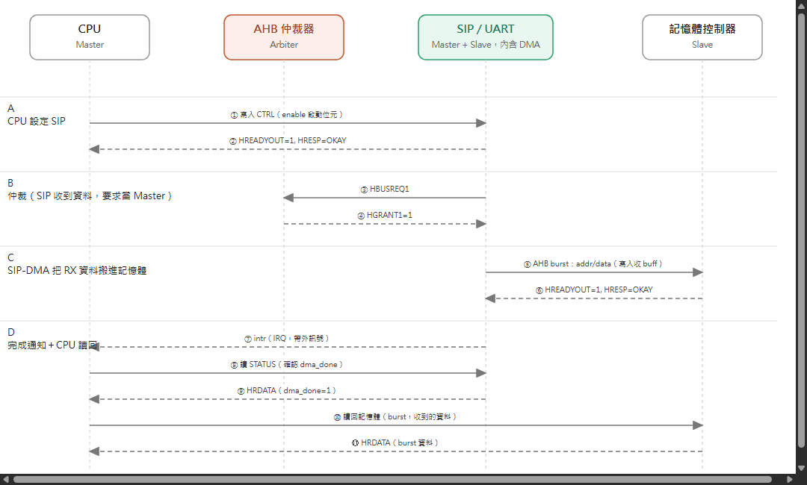

# Message Sequence Chart — AHB

依作業要求的參與者：**CPU (Master)**、**Mem Controller (Slave)**、**SIP = UART (Master + Slave，
內含 DMA 引擎)**，圖上另外畫出 **AHB 仲裁器** 這個角色，把「誰拿到匯流排」的步驟畫明確一點。
情境：CPU 先啟動 UART，收滿幾個 byte 的 RX 資料後由 DMA 搬到記憶體，最後 SIP 發中斷、CPU 讀狀態
再把記憶體裡的資料讀回來。

🔍 [看大圖](https://raw.githubusercontent.com/shj-F115112128/SOC_Practice/main/HW1/Upload/image/ahb_msc.drawio.png) ／
原始檔：[Upload/ahb_msc.drawio](../Upload/ahb_msc.drawio)

## 四個階段

- **A. CPU 設定 SIP**：CPU 寫入 CTRL 的 enable 啟動位元，SIP 以 OKAY 回應。
- **B. 仲裁**：SIP 收到一筆資料後，以 Master 身份向仲裁器要求匯流排（`HBUSREQ1`），拿到
  `HGRANT1` 才能繼續。
- **C. AHB burst 搬資料**：SIP-DMA 把收到的資料整批 burst 寫進記憶體的收 buffer。
- **D. 完成通知＋CPU 讀回**：SIP 發出中斷（IRQ，帶外訊號），CPU 讀 STATUS 確認 `dma_done`
  （對應白板上的 `eject`／`MSR`），接著直接向 Mem Controller 把 burst 寫進去的資料讀回來——
  這一步是讀記憶體，不是讀 SIP 的 RXDATA（RXDATA 只用在非 DMA 的單一 byte 存取）。

B、C 兩階段都是 SIP 以 Master 身份動作，同一時間只有 CPU 或 SIP 其中一個能擁有匯流排（仲裁規則
見 [01-ahb-wrapper-fsm.md](01-ahb-wrapper-fsm.md)），所以階段 D 要等階段 C 的 burst 結束才能開始。

對稱的 TX 路徑（CPU 把資料寫進記憶體，SIP-DMA 再把資料 burst 讀出送出）形狀相同，只是階段 C 的
方向反過來，這裡沒有另外畫一張圖。
