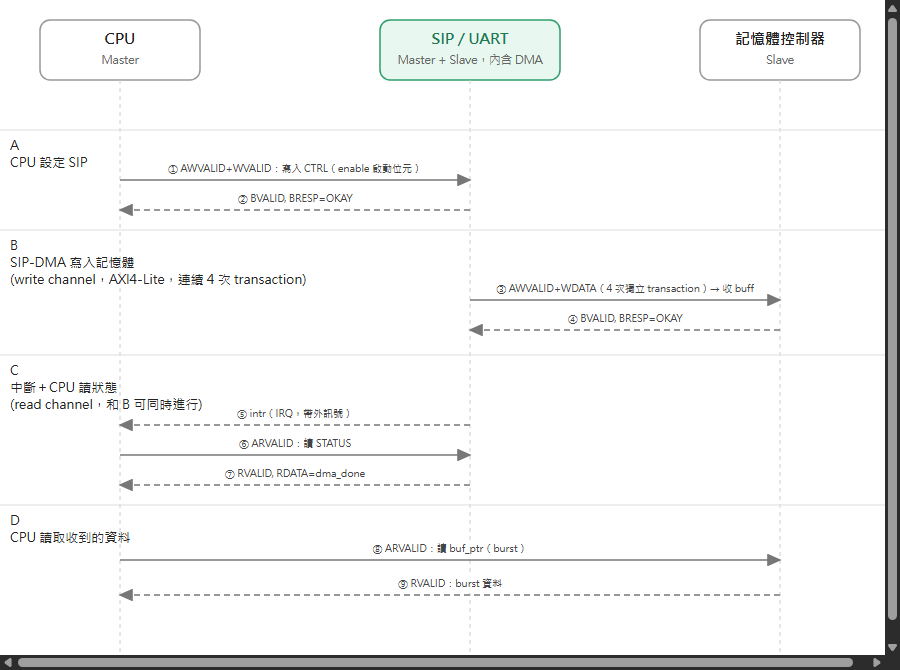

# Message Sequence Chart — AXI

與 [03-msc-ahb.md](03-msc-ahb.md) 相同的情境與參與者 — **CPU (M)**、**Mem Controller (S)**、
**SIP = UART (M+S，含 DMA)** — 改用 AXI channel 重畫。因為 write（AW/W/B）跟 read（AR/R）channel
彼此獨立，AXI 版不需要像 AHB 版那樣畫一個獨立的仲裁角色，也不用等 write burst 完全結束才能讀
狀態。

🔍 [看大圖](https://raw.githubusercontent.com/shj-F115112128/SOC_Practice/main/HW1/Upload/image/axi_msc.drawio.png) ／
原始檔：[Upload/axi_msc.drawio](../Upload/axi_msc.drawio)

## 四個階段

- **A. CPU 設定 SIP**：CPU 透過 AW/W 寫入 CTRL 的 enable 啟動位元，SIP 以 `BRESP=OKAY` 回應。
- **B. SIP-DMA 寫入記憶體**：收到資料後，SIP 以 master 身份對記憶體連續發出幾次獨立的 AXI4-Lite
  write transaction（AXI4-Lite 本身沒有 burst，這裡用連續幾筆單一 transaction 代表），把資料
  搬進記憶體的收 buffer。
- **C. 中斷＋CPU 讀狀態**：SIP 發出中斷，CPU 用自己獨立的 read channel 讀 STATUS — 這一步可以
  跟階段 B 還在進行的 write channel **同時發生**，因為 write（AW/W/B）跟 read（AR/R）本來就是
  兩組完全獨立的訊號線，不像 AHB 共用同一條位址/資料匯流排需要仲裁。
- **D. CPU 讀取資料**：CPU 再用 read channel，向記憶體連續讀出 DMA 寫進去的資料。

對稱的 TX 路徑（CPU 寫資料進記憶體，SIP-DMA 再用它的 read-DMA FSM 把資料讀出送出）跟階段 B 形狀
相同，只是方向相反，這裡沒有另外畫一張圖。channel FSM 細節見
[02-axi-wrapper-fsm.md](02-axi-wrapper-fsm.md)。
