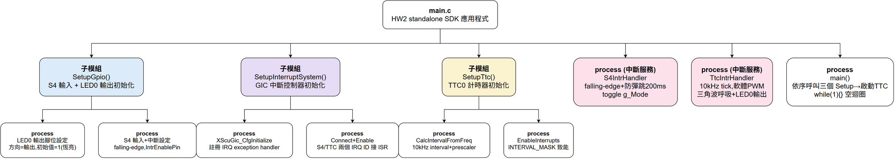
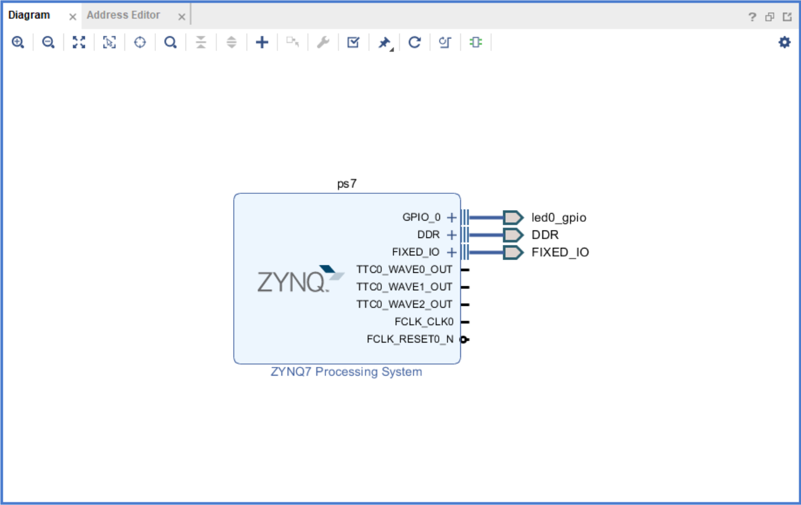
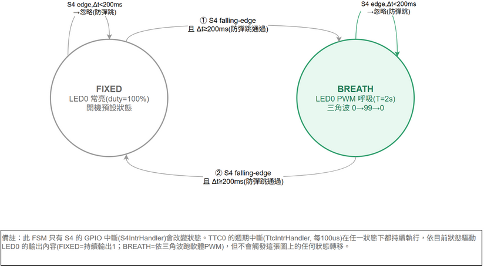
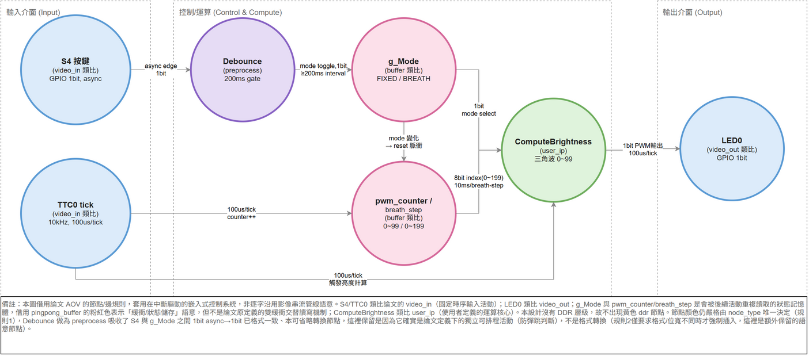
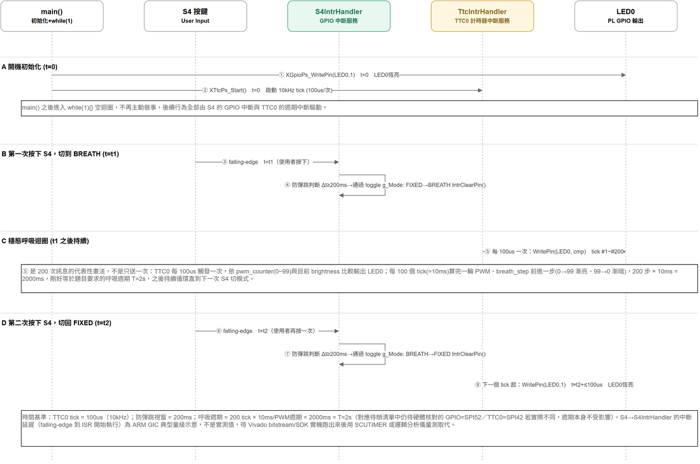

# HW2 — Zynq-7020 中斷與 LED/Push Button 驅動

平台：EGO-XZ7（Zynq-7000, XC7Z020），開發環境 Vivado + Xilinx SDK。

## 作業要求（課堂白板, 2026-10-17）

1. 找 SoC（Zynq-7020）的手冊：**User Guide (UG xx)** + **Programming Guide**，從中找出跟
   BSP（Board Support Package）、ISR() 相關的章節。
2. 在 UG 裡找出**中斷相關的 port（有位址的暫存器）**。
3. 寫程式：
   1. 先隨便點亮一個 LED：C（SDK）→ 燒進 FPGA（Vivado）→ LED 亮。
   2. 按 push button 之後，LED 要有客製化反應：用第 2 步找到的暫存器資訊，寫 **Driver +
      特別的 ISR**（中斷服務常式）。

> 原始白板照片：[`whiteboard-2026-10-17.jpg`](whiteboard-2026-10-17.jpg)（HW2 這週作業內容，
> 含右側 IRQ 向量表草圖，標記這次用的中斷編號 #4）。

## 功能規格（已決定）

- 輸入：**S4**（PS MIO_51 push button）
- 輸出：**LED0**（PL fabric pin T22）
- 行為：
  1. 開機預設 LED0 **固定恆亮**。
  2. 按一下 S4 → 切換成**呼吸燈**，週期 T = 2 秒（亮度持續漸增漸減循環）。
  3. 再按一下 S4 → 切回**固定恆亮**。
  4. 之後每按一次 S4 就在這兩個狀態之間切換（edge-triggered toggle）。

老師指定要用中斷控制，所以按鍵偵測走 **S4 的 GPIO 中斷**（PS GPIO interrupt via GIC），
不是 SDK 主迴圈輪詢（polling）；中斷邏輯都在 SDK 端的 ISR 裡處理，Vivado 端只需要把
硬體接好。

## 文件手冊 — 待確認

白板上要找的「Zynq-7020 的手冊」是 Xilinx 原廠的晶片等級文件（例如 Zynq-7000 Technical
Reference Manual / Register Reference，UG585 一類），裡面才會列出 PS 中斷控制器
（GIC）、GPIO 等**有位址的暫存器**。目前本機只有 `D:\Hardware\EGO-XZ7 User guide V1.2.pdf`，
這份是 **EGO-XZ7 板子的硬體手冊**（排針、原理圖、LED/按鈕/開關的 FPGA pin 對應表），
不含 PS 暫存器位址 — 兩份是不同文件，步驟 1、2 要查的是 Xilinx 的晶片手冊，不是這份板子
手冊。等拿到實際的 Xilinx UG/Programming Guide 檔案後，再補上實際章節連結與暫存器清單。

## 板上可用的輸入/輸出（摘自 EGO-XZ7 User Guide V1.2, §2.9）

LED 全部在 PL（FPGA fabric）這側，8 顆：

| 訊號 | FPGA Pin |
|---|---|
| LED0 | T22 |
| LED1 | T21 |
| LED2 | U22 |
| LED3 | U21 |
| LED4 | V22 |
| LED5 | W22 |
| LED6 | U19 |
| LED7 | U14 |

Push button 分兩種，對後面「用哪個 port 做中斷」很關鍵：

| 訊號 | 接到哪裡 | FPGA Pin |
|---|---|---|
| S3 | **PS MIO_50**（直接接 Zynq PS GPIO，可用 PS GPIO 中斷） | D13 |
| S4 | **PS MIO_51**（同上） | C10 |
| S5 (BTNU) | PL fabric I/O | T18 |
| S6 (BTNC) | PL fabric I/O | P16 |
| S7 (BTNL) | PL fabric I/O | N15 |
| S8 (BTNR) | PL fabric I/O | R18 |
| S9 (BTND) | PL fabric I/O | R16 |

User Switch SW0~SW7 也都在 PL fabric（F22/G22/H22/F21/H19/H18/H17/M15），跟 S5~S9 一樣
是 PL I/O，本身沒有中斷能力，要接中斷的話得透過 PL 端的 AXI GPIO IP（IP 本身有
interrupt output，再接到 PS 的中斷輸入）才能產生中斷訊號給 GIC。

**已決定：用 S4（PS MIO 按鈕）。** 直接是 PS GPIO，走 PS 內建的 GPIO controller + GIC，
暫存器位址在 Zynq-7000 TRM 裡查得到，Vivado 端不用加 PL 端的 AXI GPIO IP 來做輸入，中斷
處理全部在 SDK 這邊用 `XScuGic` 寫 ISR。

**LED0 是 PL fabric pin（T22），不是 PS MIO**，所以輸出這邊要讓 PS 能夠驅動一個 PL 腳位。
最簡單的做法是在 block design 把 **PS7 的 GPIO 用 EMIO 多拉一條出來**接到頂層 port、
再用 XDC 把這個 port 綁到 LED0 的 T22 pin，SDK 端一樣用 `XGpioPs` 對這個 EMIO bit 做輸出
（不需要額外的 PL IP）。

**呼吸燈（T=2s）不是單純開/關，需要 PWM 概念才能做出亮度漸變**：
- 用一顆週期性計時器中斷（例如 PS 的 TTC, Triple Timer Counter）當作 PWM 的高速載波
  （carrier），在 ISR 裡用「on 多久、off 多久」控制瞬間亮度（軟體 PWM）。
- 另外維護一個獨立的計數/變數，隨時間在 2 秒內把 duty cycle 從 0 爬升到最大、再降回 0，
  形成呼吸的漸亮漸暗效果。
- S4 的 ISR 本身很單純：只負責 toggle 一個模式旗標（固定恆亮 / 呼吸燈），真正的
  PWM/呼吸邏輯跑在計時器中斷或主迴圈裡，兩個中斷來源要分開看（**S4 GPIO 中斷**＝按鍵
  事件，**TTC 計時器中斷**＝PWM 載波），這也呼應白板上畫的多個 IRQ 向量。

## SDK 程式架構

[`sdk/src/main.c`](sdk/src/main.c) — standalone BSP，三個部分：

- **S4 GPIO 中斷**（`S4IntrHandler`）：falling-edge 觸發，只做防彈跳 + toggle 一個模式旗標
  （`LED_MODE_FIXED` / `LED_MODE_BREATH`），不碰 PWM 細節。
- **TTC 週期中斷**（`TtcIntrHandler`）：10kHz tick 當軟體 PWM 的載波（100 階亮度 → PWM 頻率
  100Hz，不閃爍）；依目前模式輸出固定恆亮，或依三角波（`ComputeBrightness`）算出瞬時亮度，
  200 步 × 10ms/步 = 2 秒一個完整呼吸週期，剛好對上 T=2s 的要求。
- **`main()`**：初始化 GPIO/GIC/TTC、接好兩個中斷來源後主迴圈空轉，所有行為都由中斷驅動。

檔案開頭註記了目前寫死的腳位/中斷 ID（S4=MIO_51、LED0=EMIO bit0=pin 54、
`XPAR_XGPIOPS_0_INTR`、`XPAR_XTTCPS_0_INTR`），這些要等 Vivado block design 匯出
`xparameters.h` 後再核對、必要時修正。

## Vivado Block Design

[`vivado/create_bd.tcl`](vivado/create_bd.tcl) + [`vivado/constraints/hw2.xdc`](vivado/constraints/hw2.xdc)
— 已經在 Vivado 2018.2 batch mode 實際建出來跑過 `validate_bd_design`，不是只有紙上規劃。

設計本身很單純：**只有 PS7 一顆 IP，完全沒有 PL 邏輯**。

- 關掉 `M_AXI_GP0`（S4、LED0 都不經過 PL 的 AXI 介面，PL 端不需要任何時脈接線）。
- S4（MIO_51）走 PS 內建 GPIO，開 `PCW_GPIO_MIO_GPIO_ENABLE`，MIO_50/51 內部 pull-up 開啟。
- LED0 是 PL pin（T22），用 `PCW_GPIO_EMIO_GPIO_WIDTH=1` 多拉一條 EMIO GPIO 出來，
  對 GPIO interface 做「Make External」。Vivado 產生 wrapper 時會**自動插入 IOBUF**
  把 O/T/I 三條線包成一個 inout port `led0_gpio_tri_io[0]`，不用自己手刻 IOBUF。
- TTC0 預設是關閉的，要手動開 `PCW_TTC0_PERIPHERAL_ENABLE=1` 才能用（這顆是呼吸燈軟體
  PWM 的計時器來源）。
- DDR / FIXED_IO / PS_CLK 照標準流程拉到外部。

**實測時發現一個跟板子手冊對不上的地方：** EGO-XZ7 UG 的 OCR 文字說 MIO_50/51 所在的
bank（Bank501）是 1.8V，但 Vivado 的 PS7 IP 對這顆 part（XC7Z020-CLG484）直接把
`PCW_MIO_50_IOTYPE` 限制成只能選 `LVCMOS 3.3V`（硬改成 1.8V 會報錯 out of range）。
以 Vivado IP 本身的限制為準，`create_bd.tcl` 裡沒有去覆寫這個值。

產生 HDL wrapper 後確認的 top-level port：`led0_gpio_tri_io[0]`（LED0 用），
`hw2.xdc` 把它綁到 T22、`IOSTANDARD LVCMOS33`（LED 那顆 bank 本身是 3.3V，沒有疑義）。
S3/S4 走 MIO，是晶片內部固定接線，不需要（也不能）另外下 XDC。

這次只驗證到 **block design 的連線/參數合法性**，還沒跑 synthesis/implementation/產生
bitstream，也還沒匯出 `xparameters.h` 核對中斷 ID。

## 圖表

> 圖都用 [draw.io](https://www.diagrams.net/) 畫，原始 `.drawio` 檔放在
> [`Upload/`](Upload/)，匯出的 PNG 放在 [`Upload/image/`](Upload/image/) 並直接嵌在下面；
> 圖說下方附「🔍 看大圖」連結可看原始解析度，也連到可編輯的 `.drawio` 原始檔（跟 HW1 同一套
> 慣例）。

### 1. Breakdown（模組/process 拆解樹）

🔍 [看大圖](https://raw.githubusercontent.com/shj-F115112128/SOC_Practice/main/HW2/Upload/image/breakdown.drawio.png) ／
原始檔：[Upload/breakdown.drawio](Upload/breakdown.drawio)

`main.c` 的三個 `Setup*()` 子模組 + 兩個中斷服務常式（ISR）+ `main()` 本身，畫法沿用
`Lab_hardware_practice` 系列的 breakdown tree 風格（子模組=彩色方塊，process=白色葉節點）。

### 2. 方塊電路圖（Vivado Block Design）

🔍 [看大圖](https://raw.githubusercontent.com/shj-F115112128/SOC_Practice/main/HW2/Upload/image/block_diagram.drawio.png)
（這張是直接截 Vivado Block Design 畫面，不是 `.drawio` 來源；檔名沿用慣例方便跟其他圖放
在同一個資料夾。原始可重建腳本：[`vivado/create_bd.tcl`](vivado/create_bd.tcl)）

`ps7` 只有三個對外接口：`led0_gpio`（EMIO，接 LED0）、`DDR`、`FIXED_IO`。`TTC0_WAVE*_OUT`、
`FCLK_CLK0`、`FCLK_RESET0_N` 這幾根留在圖上但沒接線，是 PS7 IP 預設就會畫出來的可選接腳，
這個設計用不到（TTC0 中斷走內部路徑，不需要外部 WAVE 腳位；沒有 PL 邏輯所以也不需要
FCLK/RESET 接給任何東西）——跟第 1 節 Breakdown 圖對照：S4 對應的 MIO 腳位是 PS7 內部晶片
固定接線，不會出現在 block design 畫面上。

### 3. FSM（LED 模式狀態機）

🔍 [看大圖](https://raw.githubusercontent.com/shj-F115112128/SOC_Practice/main/HW2/Upload/image/led_mode_fsm.drawio.png) ／
原始檔：[Upload/led_mode_fsm.drawio](Upload/led_mode_fsm.drawio)

沿用 HW1（`ahb_slave_fsm.drawio`）的配色：灰=idle-like 的 `FIXED` 狀態，綠=active 的
`BREATH` 狀態。只有 `S4IntrHandler` 會觸發狀態轉移，`TtcIntrHandler` 的週期中斷在任一狀態下
都持續執行但不改變這張圖上的狀態。

### 4. AOV（Activity-on-Vertex）

🔍 [看大圖](https://raw.githubusercontent.com/shj-F115112128/SOC_Practice/main/HW2/Upload/image/aov.drawio.png) ／
原始檔：[Upload/aov.drawio](Upload/aov.drawio)

依照
`D:\Hardware\PARER\梓維的論文\電腦視覺加速系統晶片之階層式記憶體架構多目標最佳化_論文初稿.pdf`
3.1.3/3.1.4 節的 AOV 規則畫：節點一律圓形、顏色由 `node_type` 唯一決定（不因階段改變）、
有向邊標傳輸週期/格式/位寬。這張圖把論文原本針對影像串流管線（VI/IP/VO）的規則，類比套用到
HW2 這個中斷驅動的嵌入式控制系統上——S4/TTC0 類比 `video_in`，LED0 類比 `video_out`，
`g_Mode`/`pwm_counter`/`breath_step` 借用 `pingpong_buffer`（粉紅）表示「狀態記憶體」但不是
論文原定義的雙緩衝交替讀寫，`ComputeBrightness` 類比 `user_ip`；沒有 DDR 層級，所以不出現
黃色節點。這些跨領域類比都寫在圖說備註裡，不是逐字沿用論文的影像處理語意。

### 5. MSC (timespec)

🔍 [看大圖](https://raw.githubusercontent.com/shj-F115112128/SOC_Practice/main/HW2/Upload/image/msc_timespec.drawio.png) ／
原始檔：[Upload/msc_timespec.drawio](Upload/msc_timespec.drawio)

沿用 HW1（`ahb_msc.drawio`）的畫法：方框 actor + 虛線生命線 + 場景分隔線，5 個 actor
（`main()`/S4按鍵/`S4IntrHandler`/`TtcIntrHandler`/LED0）、4 個場景（A 開機初始化、B 第一次
按 S4 切到 BREATH、C 穩態呼吸迴圈、D 第二次按 S4 切回 FIXED）。比 HW1 的 MSC 多了明確時間戳：
TTC0 tick=100us、防彈跳視窗=200ms、呼吸週期=200 tick×10ms=2000ms=T=2s。圖說備註裡也老實
標註「S4→ISR 中斷延遲是 ARM GIC 典型量級示意，不是實測值」，跟 HW1 一貫的「理論值 vs. 實測值
分開講」原則一致。

## 待辦

- [x] 確認輸入/輸出：S4（PS MIO_51）+ LED0（PL T22）
- [x] 確認用 PS MIO 中斷（不用 PL AXI GPIO 中斷）
- [x] SDK 程式架構：S4 ISR + TTC 軟體 PWM 呼吸燈 + 狀態機（[`sdk/src/main.c`](sdk/src/main.c)）
- [x] Vivado block design：PS7-only，EMIO 接 LED0，validate_bd_design 通過
      （[`vivado/create_bd.tcl`](vivado/create_bd.tcl)）
- [x] Breakdown / FSM / AOV / MSC(timespec) 四張圖（見上方「圖表」）
- [x] 方塊電路圖：Vivado BD 實際截圖（見上方第2節）
- [ ] 取得 Xilinx Zynq-7020 的 UG / Programming Guide，核對本文件寫死的暫存器/中斷 ID
      （GPIO=SPI 52、TTC0 counter0=SPI 42，來自 UG585，還沒拿到官方文件逐條核對）
- [ ] Vivado：Generate Bitstream → Export Hardware（含 bitstream）
- [ ] 匯出 `xparameters.h` 後回頭核對 `main.c` 裡的裝置 ID / 中斷 ID 巨集
- [ ] 實機測試：開機固定恆亮 → 按 S4 進入呼吸燈、確認週期約 2 秒 → 再按一下切回固定恆亮
