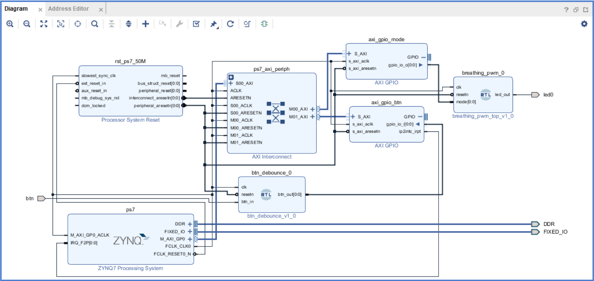
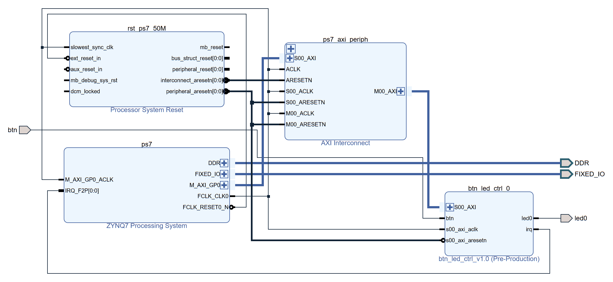
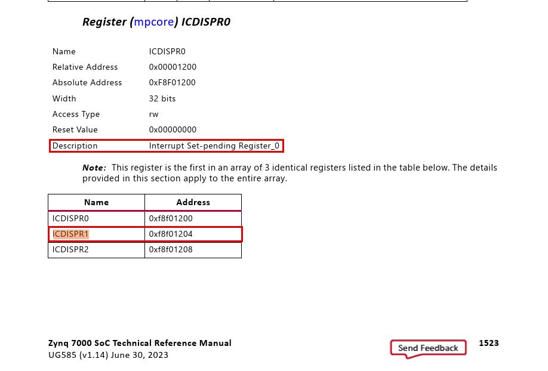
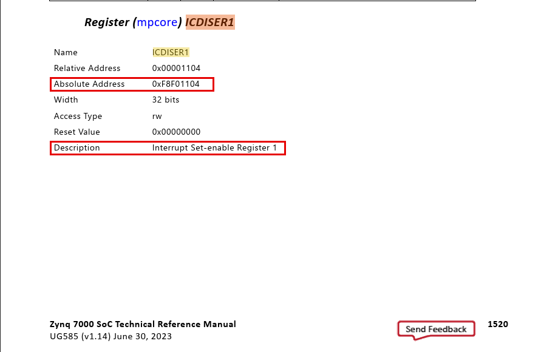

# HW2：Zynq-7020 中斷與 LED/Push Button 驅動

平台：EGO-XZ7（Zynq-7000, XC7Z020），開發環境 Vivado 2018.2 + Xilinx SDK 2018.2。

## 題目

1. 從 Zynq-7020 的手冊找出跟 BSP（Board Support Package）、ISR 相關的章節。
2. 找出中斷控制器相關的暫存器：1. IRQ #（port）、2. pending register（port status）、
   3. mask register（port enable）。
3. 按下 push button 產生中斷，按鈕訊號經過 FPGA（PL）再進中斷控制器；用找到的暫存器寫
   Driver + ISR，讓 LED 有客製化反應。
4. 把 `btn_debounce_0`、`axi_gpio_btn`、`axi_gpio_mode`、`breathing_pwm_0` 四個方塊包成一顆 IP wrapper，
   一樣透過 irq 發中斷給 CPU，並透過 AXI 接收 CPU 的指令；中斷發生時透過 AXI 把資料傳給 CPU。

## 功能規格

輸入 S6（BTNC，PL pin P16，按下 = 1），輸出 LED0（PL pin T22），按鍵偵測全用中斷、不 polling。兩個版本的中斷都從
`IRQ_F2P[0]` 進 GIC，IRQ ID 都是 61。

| 版本 | PL 端 | 行為 | C 程式 |
|---|---|---|---|
| 一 | AXI GPIO ×2 + 自寫 `btn_debounce`、`breathing_pwm` | 開機恆亮，每按一次 S6 在恆亮 / 呼吸燈（週期約 3.75 秒）間切換 | [`sdk/src/main.c`](sdk/src/main.c)，BSP `xgpio` / `xscugic` |
| 二 | 四個方塊包成自製 AXI4-Lite IP `btn_led_ctrl`，加上手勢判斷、亮度 / 速度控制 | 見下表 | [`sdk/src_ip/main.c`](sdk/src_ip/main.c)，`Xil_In32` / `Xil_Out32` + `xscugic` |

版本二由 IP 用硬體判斷手勢，每種手勢各自發中斷：

| S6 手勢 | 硬體判斷條件 | CPU 收到中斷後 |
|---|---|---|
| 單擊 | 放開後 300 ms 內沒有再按 | 切換恆亮 / 呼吸 |
| 雙擊 | 放開後 300 ms 內再按一次 | 恆亮亮度 31 → 8 → 2 → 31（31 = 全亮） |
| 長按 | 按住滿 1 秒（不用放開就觸發） | 呼吸週期 3.75 s → 1.9 s → 0.94 s → 0.47 s → 3.75 s |
| 按下 / 放開 | 防彈跳後的電位變化 | 只記錄；放開時印出硬體量到的按住時間 |

每次中斷 ISR 透過 AXI 讀回 IP 準備好的 `DATA_OUT`（CPU 先寫進 `DATA_IN` 的值 + 事件次數）、`EVENT_CNT`、`HOLD_MS`。

## Demo

https://github.com/user-attachments/assets/532a838b-4841-4d1e-b7c7-504c3906d9c9

影片是版本二（依序單擊 → 長按三次 → 單擊 → 雙擊三次），檔案另存在 [`Upload/video/hw2_demo_ip.mp4`](Upload/video/hw2_demo_ip.mp4)。

[`demo/`](demo/) 裡雙擊 `demo.bat`（版本一）或 `demo_ip.bat`（版本二）會燒 bitstream、初始化 PS、下載 ELF 並執行，
詳見 [`demo/README.md`](demo/README.md)。用 SDK 執行時 Run Configuration 要勾 Reset entire system、Program FPGA；
stdout 是 JTAG UART（硬體沒開 PS UART），輸出在 Console 分頁的 **TCF Debug Virtual Terminal**，不在 COM port。

每次進 ISR 印一行。版本二輸出節錄（單擊、長按、雙擊）：

```
IRQ 61 #1: PRESS  | DATA_OUT = 1001 (DATA_IN 1000 + EVENT_CNT 1)
IRQ 61 #2: RELEASE(held 147 ms)  | DATA_OUT = 1002 (DATA_IN 1000 + EVENT_CNT 2)
IRQ 61 #3: CLICK -> mode = BREATH  | DATA_OUT = 1003 (DATA_IN 1000 + EVENT_CNT 3)
IRQ 61 #4: PRESS  | DATA_OUT = 1004 (DATA_IN 1000 + EVENT_CNT 4)
IRQ 61 #5: LONG -> speed = 1.9 s  | DATA_OUT = 1005 (DATA_IN 1000 + EVENT_CNT 5)
IRQ 61 #6: RELEASE(held 1998 ms)  | DATA_OUT = 1006 (DATA_IN 1000 + EVENT_CNT 6)
...
IRQ 61 #18: PRESS  | DATA_OUT = 1018 (DATA_IN 1000 + EVENT_CNT 18)
IRQ 61 #19: RELEASE(held 147 ms) DOUBLE -> bright = 8/31  | DATA_OUT = 1019 (DATA_IN 1000 + EVENT_CNT 19)
```

雙擊的第二次放開跟雙擊判定在同一拍，所以印在同一行。版本一則是按下、放開各印一行，只有按下才切換模式。

## Vivado Block Design

### 版本一：AXI GPIO + 自寫 RTL


[看大圖](https://raw.githubusercontent.com/shj-F115112128/SOC_Practice/master/HW2/Upload/image/block_design.png)
（重建腳本：[`vivado/create_bd.tcl`](vivado/create_bd.tcl)）

- `ps7`：`M_AXI_GP0` 存取 PL、`IRQ_F2P[0]` 收中斷、`FCLK_CLK0` / `FCLK_RESET0_N` 給 PL。
- `ps7_axi_periph`：AXI Interconnect，分給 `axi_gpio_mode`、`axi_gpio_btn`。
- `rst_ps7_50M`：把 PS 的非同步 reset 同步到 50 MHz；拿掉會有 8 個 `CRITICAL WARNING [BD 41-1348]`。
- `axi_gpio_btn`（1 bit 輸入，開中斷）← `btn_debounce_0` ← S6；`ip2intc_irpt` → `IRQ_F2P`。
- `axi_gpio_mode`（1 bit 輸出）→ `breathing_pwm_0` 的 `mode` → LED0。

### 版本二：IP 封裝（`btn_led_ctrl`）


[看大圖](https://raw.githubusercontent.com/shj-F115112128/SOC_Practice/master/HW2/Upload/image/block_design_ip.png)
（重建腳本：[`vivado/create_bd_ip.tcl`](vivado/create_bd_ip.tcl)）

BD 只剩 `ps7`、`ps7_axi_periph`、`rst_ps7_50M` 和自製 IP `btn_led_ctrl_0`（[`ip_repo/btn_led_ctrl_1.0`](ip_repo/btn_led_ctrl_1.0)，
位址 `0x43C00000`；`btn` 接 S6、`led0` 接 LED0、`irq` 接 `IRQ_F2P[0]`）。四個方塊在 IP 裡的對應：

| 原本的方塊 | 在 IP 裡變成 |
|---|---|
| `btn_debounce_0` | `u_btn_debounce`，同一份 VHDL |
| `breathing_pwm_0` | `u_breathing_pwm`，除頻值改成 `div_n` 輸入，接 `SPEED` 暫存器 |
| `axi_gpio_mode` | `CTRL` bit0 直接接 `mode` |
| `axi_gpio_btn` | `STATUS`、`INT_STATUS`、`INT_ENABLE` + `irq` |
| （新增） | 手勢 FSM、`HOLD_MS`、`DATA_IN` / `DATA_OUT` / `EVENT_CNT`、恆亮亮度 PWM |

暫存器（基底 `0x43C00000`）：

| Offset | 名稱 | 存取 | 內容 |
|---|---|---|---|
| `0x00` | `CTRL` | R/W | bit0 `mode`：0 恆亮、1 呼吸 |
| `0x04` | `STATUS` | RO | bit0 防彈跳後的按鈕電位 |
| `0x08` | `INT_STATUS` | R/W1C | bit0 按下、bit1 放開、bit2 單擊、bit3 雙擊、bit4 長按；寫 1 清除 |
| `0x0C` | `INT_ENABLE` | R/W | bit[4:0] 各中斷的開關 |
| `0x10` | `DATA_IN` | R/W | CPU 寫給 IP 的資料 |
| `0x14` | `DATA_OUT` | RO | 中斷事件那一拍鎖住 `DATA_IN + EVENT_CNT` |
| `0x18` | `EVENT_CNT` | RO | 中斷事件次數 |
| `0x1C` | `HOLD_MS` | RO | 放開時鎖住按住幾 ms |
| `0x20` | `SPEED` | R/W | 呼吸除頻 = 12207 >> `SPEED`：3.75 / 1.9 / 0.94 / 0.47 s |
| `0x24` | `BRIGHT` | R/W | 恆亮亮度 0～31，重置值 31 |

`irq = |(INT_STATUS & INT_ENABLE)`，清掉前一直維持 High（level），跟 `ip2intc_irpt` 行為相同，GIC 設定不用改。

手勢判斷 FSM（1 ms 時基 = 50 MHz ÷ 50000）：

| 狀態 | 轉移 |
|---|---|
| `S_IDLE` | 按下 → `S_PRESS1` |
| `S_PRESS1` | 放開 → `S_WAIT2`；按滿 1000 ms → `S_LONG`，發長按 |
| `S_WAIT2` | 300 ms 內再按 → `S_PRESS2`；滿 300 ms → `S_IDLE`，發單擊 |
| `S_PRESS2` | 放開 → `S_IDLE`，發雙擊；按滿 1000 ms → `S_LONG`，發長按 |
| `S_LONG` | 放開 → `S_IDLE`（不再發單擊） |

按下、放開兩個中斷跟 FSM 無關，防彈跳後的電位一變就發。

## 文件手冊

| 手冊 | 用途 |
|---|---|
| UG585 Zynq-7000 TRM（v1.14），[線上版](https://docs.amd.com/r/en-US/ug585-zynq-7000-SoC-TRM) | GIC、IRQ ID 表、暫存器位址 |
| UG821 Zynq 7000 Software Developers Guide（v13.0） | BSP / standalone driver 架構，ISR 透過 GIC driver（`xscugic`）註冊 |
| PG144 AXI GPIO Product Guide | `GPIO_DATA`、`GIER`、`IPISR`、`IPIER` |
| EGO-XZ7 User Guide V1.2 | 按鈕 / LED 的 FPGA pin（不含暫存器位址） |

頁碼都是 UG585 的 PDF 頁碼，截圖在 [`Upload/image/ug585/`](Upload/image/ug585/)。

## 中斷相關暫存器

中斷要經過 PL 端 IP、GIC、CPU 三層，每層都要開才會進 ISR：

```
版本一：S6 → btn_debounce → axi_gpio_btn (IPISR/IPIER/GIER) → IRQ_F2P[0]
版本二：S6 → btn_led_ctrl (INT_STATUS/INT_ENABLE，五種中斷 OR 成一條 irq) → IRQ_F2P[0]
        → GIC (ID 61: ICDISPR1/ICDISER1 bit29) → CPU (CPSR.I) → ISR
```

| 項目 | 版本一 `axi_gpio_btn`（`0x41210000`） | 版本二 `btn_led_ctrl`（`0x43C00000`） | GIC（UG585） |
|---|---|---|---|
| 1. IRQ # | `ip2intc_irpt` → `IRQ_F2P[0]` | 五種中斷 → `irq` → `IRQ_F2P[0]` | **ID 61**，p.238 |
| 2. pending | `IPISR` bit0（`+0x120`） | `INT_STATUS` bit[4:0]（`+0x08`） | `ICDISPR1` **bit29**（`0xF8F01204`），p.1523 |
| 3. mask | `IPIER` bit0（`+0x128`）+ `GIER` bit31（`+0x11C`） | `INT_ENABLE` bit[4:0]（`+0x0C`） | `ICDISER1` **bit29**（`0xF8F01104`），p.1520 |

`ICD*1` 管 ID 32～63，所以 61 - 32 = bit29。最後 CPU 的 CPSR.I 要清 0（`Xil_ExceptionEnable()`）才會接 IRQ。

### 1. IRQ #：port


Table 7-4 的 PL [2:0]：`IRQF2P[2:0]` 對應 ID 63:61，所以 `IRQ_F2P[0]` 是 61；`xparameters.h` 的中斷 ID 也是 61U。
版本二五種中斷共用一條 `irq`，都進同一個 ISR，由 ISR 讀 `INT_STATUS` 分辨（同 AXI GPIO 用 `IPISR` 的做法）。

### 2. Pending register：port status



`ICDISPR1` bit29 = 1 表示 ID 61 pending，清除寫 `ICDICPR1`（`0xF8F01284`）。PL 端：`IPISR` 是 toggle-on-write，
只能對讀到 1 的 bit 寫 1；`INT_STATUS` 是 W1C，寫 0 沒作用，可一次清多個 bit。

### 3. Mask register：port enable



`ICDISER1` 寫 1 開啟（關閉寫 `ICDICER1`），上板讀到 `0x20000000`，只有 bit29。版本一 PL 端要開 `IPIER` 和總開關 `GIER`；
版本二只有 `INT_ENABLE`。

### 觸發方式


`ICDICFR` 每個 SPI 2 bit（`01` high level、`11` rising edge）；ID 61 在 `ICDICFR3` bits[27:26]（(61 - 48) × 2），
設 `01`，上板讀到 `ICDICFR3 = 0x55555555`。因為是 level 觸發，ISR 一定要清 PL 端的 pending，否則會一直重進 ISR；
版本二一次可能有多個 bit（例如放開 + 雙擊），所以讀到哪些 bit 就整個寫回去清。

每個手勢進 ISR 的次數：版本一每次按壓 2 次（按下、放開）；版本二單擊 3 次、雙擊 4 次、長按 3 次。

## 對應到 `main.c`

GIC 與 CPU 的部分兩版相同，用 BSP 的 `xscugic`：

| 步驟 | API | 暫存器 |
|---|---|---|
| GIC 初始化 | `XScuGic_LookupConfig`、`XScuGic_CfgInitialize` | `ICDICER`、`ICDIPTR`，開 distributor / CPU interface |
| 觸發方式 | `XScuGic_SetPriorityTriggerType(&Gic, 61, 0xA0, 0x1)` | `ICDIPR`、`ICDICFR3` bits[27:26] = `01` |
| 1. IRQ # → ISR | `XScuGic_Connect(&Gic, 61, Handler, ...)` | 填 BSP 的 `HandlerTable[61]` |
| 3. mask（GIC） | `XScuGic_Enable(&Gic, 61)` | `ICDISER1` bit29 |
| CPU 收 IRQ | `Xil_ExceptionRegisterHandler`、`Xil_ExceptionEnable` | IRQ 向量 → `XScuGic_InterruptHandler`，CPSR.I = 0 |

中斷進來後 `XScuGic_InterruptHandler` 讀 `ICCIAR` 拿到 61，呼叫 `HandlerTable[61]`，返回後寫 `ICCEOIR`。

### 版本一

[`sdk/src/main.c`](sdk/src/main.c)：`XGpio_SetDataDirection` 設方向（`GPIO_TRI`），`XGpio_InterruptEnable` /
`XGpio_InterruptGlobalEnable` 開 `IPIER` / `GIER`。`S6IntrHandler` 用 `XGpio_InterruptGetStatus` / `XGpio_InterruptClear`
讀清 `IPISR`，`XGpio_DiscreteRead` 讀到 1（按下）才用 `XGpio_DiscreteWrite` 切換 `mode`。

### 版本二

[`sdk/src_ip/main.c`](sdk/src_ip/main.c)：自製 IP 沒有 BSP driver，用 `Xil_In32` / `Xil_Out32` 直接讀寫
（`XPAR_BTN_LED_CTRL_0_S00_AXI_BASEADDR` + offset）。

| 步驟 | 程式 |
|---|---|
| 初始狀態、CPU 寫資料給 IP | `CTRL` = 0、`SPEED` = 0、`BRIGHT` = 31、`DATA_IN` = 1000 |
| 清開機前的 pending | `INT_STATUS` 寫 `0x1F` |
| GIC、CPU | 同上表，ISR 是 `BtnIntrHandler` |
| 3. mask（IP） | GIC 都設好後最後才寫 `INT_ENABLE` = `0x1F` |
| 2. pending 讀取 / 清除 | `Status = Xil_In32(REG_INT_STATUS)`、`Xil_Out32(REG_INT_STATUS, Status)` |
| 單擊 / 雙擊 / 長按 | 寫 `CTRL` / `BRIGHT` / `SPEED` |
| 讀 IP 的資料 | `DATA_OUT`、`EVENT_CNT`、`HOLD_MS` |

ISR 把每筆紀錄放進 16 格環形緩衝區，由 `main()` 印到 JTAG UART，連續很快的事件（例如雙擊）也不會漏印。

## PL 端 RTL

| 檔案 | 內容 | 驗證（xsim PASS） |
|---|---|---|
| [`btn_debounce.vhd`](vivado/rtl/btn_debounce.vhd) | 2 級同步器 + 防彈跳，輸入連續 20 ms 不變才採用 | [`tb_btn_debounce.vhd`](vivado/rtl/tb_btn_debounce.vhd)：按下、放開各彈跳 5 次，輸出只變 2 次 |
| [`breathing_pwm_top.vhd`](vivado/rtl/breathing_pwm_top.vhd) + [`configurable_counter.vhd`](vivado/rtl/configurable_counter.vhd) | 每 12207 clk 一個 tick（約 4096 Hz），PWM 週期 31 tick，每 8 個週期亮度 ±1，0→31→0 共 62 階約 3.75 秒 | [`tb_breathing_pwm.vhd`](vivado/rtl/tb_breathing_pwm.vhd)：逐階檢查亮燈比例，再檢查切回恆亮 |
| [`btn_led_ctrl_v1_0.vhd`](ip_repo/btn_led_ctrl_1.0/hdl/btn_led_ctrl_v1_0.vhd) + [`btn_led_ctrl_v1_0_S00_AXI.vhd`](ip_repo/btn_led_ctrl_1.0/hdl/btn_led_ctrl_v1_0_S00_AXI.vhd)（版本二） | Vivado AXI4-Lite 範本擴成 16 個暫存器，加 `btn` / `led0` / `irq`、手勢 FSM、W1C、亮度 PWM，內含上面兩個模組 | [`tb_btn_led_ctrl.vhd`](vivado/rtl/tb_btn_led_ctrl.vhd)：AXI4-Lite 讀寫，檢查三種手勢、`HOLD_MS`、`DATA_OUT`、分開遮罩、部分 W1C、`WSTRB`、`SPEED`、`BRIGHT` |

IP 的 `src/` 裡 `btn_debounce.vhd`、`configurable_counter.vhd` 是 `vivado/rtl/` 的複本；`breathing_pwm_top.vhd` 多了 `div_n` 輸入，跟版本一的不同。

## 板上按鈕與 LED（EGO-XZ7 User Guide V1.2, §2.9）

S6（BTNC）→ PL P16，LED0 → PL T22，約束在 [`vivado/constraints/hw2.xdc`](vivado/constraints/hw2.xdc)（LVCMOS33）。

## 建置

```
cd vivado
vivado -mode batch -source create_bd.tcl    -tclargs ./build/plbtn   # 版本一
vivado -mode batch -source create_bd_ip.tcl -tclargs ./build/ipw     # 版本二（ip_repo_paths 指到 ../ip_repo）
# 之後 Generate Bitstream → Export Hardware → SDK 編譯 sdk/src/main.c 或 sdk/src_ip/main.c
```

`vivado/build/` 有 gitignore，上板用的檔案另存在 [`demo/`](demo/)；改完 `main.c` 雙擊 `demo/build_elf.bat` 重新編譯。

SDK 的 Run Configuration 沒勾 **Reset entire system** 和 **Program FPGA** 的話，PL 還是舊的 bitstream，CPU 存取
`0x43C00000` 沒人回應，下載 ELF 會出現 `Memory write error ... APB AP transaction error`。

從頭打包 IP（Vivado GUI，Target language = VHDL）：

1. Tools → Create and Package New IP → **Create a new AXI4 peripheral**，`btn_led_ctrl`，`S00_AXI` Lite Slave 32-bit；
   擴到 16 個暫存器：`C_S_AXI_ADDR_WIDTH` = 6、`OPT_MEM_ADDR_BITS` = 3，讀寫 `case` 改 4 bit。
2. Edit IP：在 `Users to add ports here` 加 `btn` / `led0` / `irq`，`Add user logic here` 加使用者邏輯，讀取 mux 改回傳唯讀暫存器。
3. Add Sources 加三個子模組（勾 Copy sources into IP Directory）。
4. Package IP：File Groups 改 `xilinx_anylanguage*`，確認 `irq` 是 `interrupt` 介面（LEVEL_HIGH），Re-Package。

改過 IP 後，用到它的專案要 Report IP Status → Upgrade Selected，再重新產生 bitstream。

## 驗證結果

- RTL：三個 testbench xsim PASS。
- 版本一：timing met、0 critical warning；debugger 讀到 `ICDISER1 = 0x20000000`、`ICDICFR3` bits[27:26] = `01`、CPSR.I = 0；
  按 S6 LED0 在恆亮和呼吸燈間切換。
- 版本二：timing met（WNS 13.060 ns、WHS 0.055 ns），666 LUT（1.3%），中斷 ID 61。上板單擊切換恆亮 / 呼吸、
  雙擊亮度變暗、長按呼吸變快，`DATA_OUT` = 1000 + `EVENT_CNT`（見 Demo 影片）。
