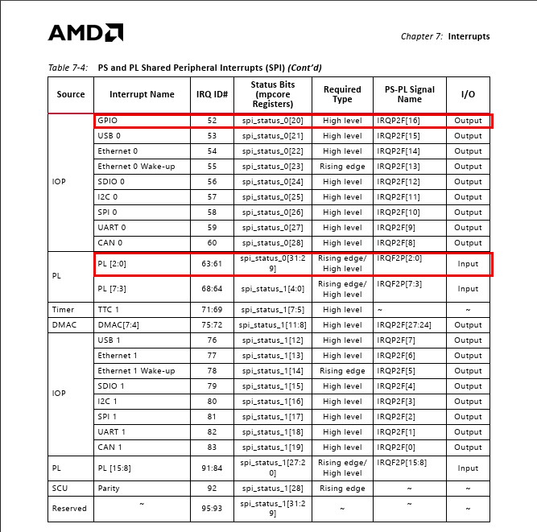
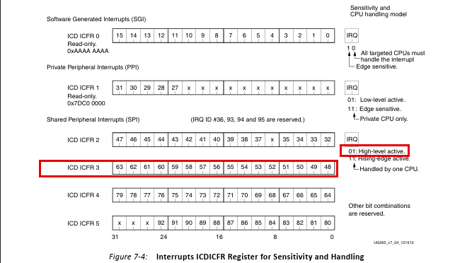

# HW2：Zynq-7020 中斷與 LED/Push Button 驅動

平台：EGO-XZ7（Zynq-7000, XC7Z020），開發環境 Vivado 2018.2 + Xilinx SDK 2018.2。

## 題目

1. 從 Zynq-7020 的手冊找出跟 BSP（Board Support Package）、ISR 相關的章節。
2. 找出中斷控制器相關的暫存器：1. IRQ #（port）、2. pending register（port status）、
   3. mask register（port enable）。
3. 按下 push button 產生中斷，按鈕訊號經過 FPGA（PL）再進中斷控制器；用找到的暫存器寫
   Driver + ISR，讓 LED 有客製化反應。
4. 把 `btn_debounce_0`、`axi_gpio_btn`、`axi_gpio_mode`、`breathing_pwm_0` 四個方塊包成一顆 IP wrapper，
   一樣透過 irq 發中斷給 CPU，並透過 AXI 接收 CPU 的指令；中斷發生時透過 AXI 把資料傳給 CPU。

## 功能規格

- 輸入：S6（BTNC），PL pin P16，按下 = 1
- 輸出：LED0，PL pin T22
- 版本一行為：
  1. 開機預設 LED0 恆亮。
  2. 按一下 S6 切換成呼吸燈，週期約 3.75 秒（漸亮、漸暗各約 1.9 秒）。
  3. 再按一下切回恆亮，之後每按一次就在兩個狀態間切換。
- 版本二行為（IP 用硬體判斷手勢，每種手勢各自發中斷）：

  | S6 手勢 | 硬體判斷條件 | CPU 收到中斷後 |
  |---|---|---|
  | 單擊 | 放開後 300 ms 內沒有再按 | 切換恆亮 / 呼吸 |
  | 雙擊 | 放開後 300 ms 內再按一次 | 恆亮亮度 31 → 8 → 2 → 31（31 = 全亮） |
  | 長按 | 按住滿 1 秒（不用放開就觸發） | 呼吸週期 3.75 s → 1.9 s → 0.94 s → 0.47 s → 3.75 s |
  | 按下 / 放開 | 防彈跳後的電位變化 | 只記錄；放開時印出硬體量到的按住時間 |

  每次中斷 IP 都會把資料準備好，ISR 透過 AXI 讀回：`DATA_OUT`（CPU 先寫進 `DATA_IN` 的值 + 事件次數）、
  `EVENT_CNT`、`HOLD_MS`。

按鍵偵測用中斷，不用主迴圈 polling。PL 端做了兩個版本：

| 版本 | PL 端 | CPU 怎麼下指令 / 收中斷 | C 程式 |
|---|---|---|---|
| 一、AXI GPIO + 自寫 RTL | `btn_debounce`、`axi_gpio_btn`、`axi_gpio_mode`、`breathing_pwm` 四個方塊 | 寫 `axi_gpio_mode` 的 `GPIO_DATA`；`axi_gpio_btn` 的 `ip2intc_irpt` 發中斷 | [`sdk/src/main.c`](sdk/src/main.c)，BSP `xgpio` / `xscugic` API |
| 二、IP 封裝 | 四個方塊包成一顆自製 AXI4-Lite IP `btn_led_ctrl`，另外加上手勢判斷、亮度 / 速度控制 | 寫 `btn_led_ctrl` 的 `CTRL` / `SPEED` / `BRIGHT` 暫存器；`btn_led_ctrl` 的 `irq` 發中斷，ISR 讀 `DATA_OUT` 等暫存器 | [`sdk/src_ip/main.c`](sdk/src_ip/main.c)，`Xil_In32` / `Xil_Out32` + `xscugic` |

兩個版本的中斷都從 `IRQ_F2P[0]` 進 GIC，IRQ ID 都是 61。每個 API 寫到哪個暫存器見[對應到 `main.c`](#對應到-mainc)。

## Demo

https://github.com/user-attachments/assets/06318f9a-7f46-473f-a88f-b6015196d532

[`demo/`](demo/) 資料夾裡雙擊 `demo.bat`（版本一）或 `demo_ip.bat`（版本二），會依序燒 bitstream、
初始化 PS、下載 ELF 並執行，詳細步驟見 [`demo/README.md`](demo/README.md)。

執行後會跳出 JTAG UART 視窗，每次進 ISR 都會印一行。影片是版本一，版本一的輸出（按下、放開各一次，只有按下才切換）：

```
IRQ 61 #1: S6 pressed , mode = BREATH
IRQ 61 #2: S6 released, mode = BREATH
IRQ 61 #3: S6 pressed , mode = FIXED
IRQ 61 #4: S6 released, mode = FIXED
```

版本二的輸出格式（依序是單擊、長按、雙擊；`held` 的 ms 數依實際按壓而定）：

```
IRQ 61 #1: PRESS  | DATA_OUT = 1001 (DATA_IN 1000 + EVENT_CNT 1)
IRQ 61 #2: RELEASE(held 132 ms)  | DATA_OUT = 1002 (DATA_IN 1000 + EVENT_CNT 2)
IRQ 61 #3: CLICK -> mode = BREATH  | DATA_OUT = 1003 (DATA_IN 1000 + EVENT_CNT 3)
IRQ 61 #4: PRESS  | DATA_OUT = 1004 (DATA_IN 1000 + EVENT_CNT 4)
IRQ 61 #5: LONG -> speed = 1.9 s  | DATA_OUT = 1005 (DATA_IN 1000 + EVENT_CNT 5)
IRQ 61 #6: RELEASE(held 1420 ms)  | DATA_OUT = 1006 (DATA_IN 1000 + EVENT_CNT 6)
IRQ 61 #7: PRESS  | DATA_OUT = 1007 (DATA_IN 1000 + EVENT_CNT 7)
IRQ 61 #8: RELEASE(held 95 ms)  | DATA_OUT = 1008 (DATA_IN 1000 + EVENT_CNT 8)
IRQ 61 #9: PRESS  | DATA_OUT = 1009 (DATA_IN 1000 + EVENT_CNT 9)
IRQ 61 #10: RELEASE(held 88 ms) DOUBLE -> bright = 8/31  | DATA_OUT = 1010 (DATA_IN 1000 + EVENT_CNT 10)
```

雙擊的第二次放開跟雙擊判定在同一拍，所以印在同一行。

## Vivado Block Design

### 版本一：AXI GPIO + 自寫 RTL


[看大圖](https://raw.githubusercontent.com/shj-F115112128/SOC_Practice/master/HW2/Upload/image/block_design.png)
（重建腳本：[`vivado/create_bd.tcl`](vivado/create_bd.tcl)）

| 方塊 | 用途 |
|---|---|
| `ps7` | Zynq PS。`M_AXI_GP0` 讓 CPU 存取 PL 的 AXI GPIO；`IRQ_F2P[0:0]` 收 PL 送來的中斷；`FCLK_CLK0` / `FCLK_RESET0_N` 提供 PL 時脈與 reset |
| `ps7_axi_periph` | AXI Interconnect，1 個 master 分給 2 個 slave（`M00_AXI` 接 `axi_gpio_mode`、`M01_AXI` 接 `axi_gpio_btn`） |
| `rst_ps7_50M` | Processor System Reset，把 PS 的非同步 reset 同步到 50 MHz 時脈再分給 PL |
| `axi_gpio_btn` | 1 bit 輸入，開 interrupt。`gpio_io_i` 接防彈跳後的按鈕，`ip2intc_irpt` 接 `IRQ_F2P` |
| `axi_gpio_mode` | 1 bit 輸出，`gpio_io_o` 接 `breathing_pwm_0` 的 `mode` |
| `btn_debounce_0` | 自寫 RTL（[`btn_debounce.v`](vivado/rtl/btn_debounce.v)），同步 + 防彈跳 |
| `breathing_pwm_0` | 自寫 RTL（[`breathing_pwm_top.vhd`](vivado/rtl/breathing_pwm_top.vhd)），依 `mode` 輸出恆亮或呼吸 PWM 到 `led0` |

`btn` 是單一訊號的 port，不是 GPIO 介面 port：按鈕要先經過 `btn_debounce` 才接到 AXI GPIO，
所以不能直接把 AXI GPIO 的 GPIO 介面 Make External。

`rst_ps7_50M` 不能拿掉。`FCLK_RESET0_N` 由軟體放開，跟 `FCLK_CLK0` 不同步，直接接到各 reset 腳的話
`validate_bd_design` 會報 8 個 `CRITICAL WARNING [BD 41-1348] ... is connected to asynchronous reset source`。

### 版本二：IP 封裝（`btn_led_ctrl`）


[看大圖](https://raw.githubusercontent.com/shj-F115112128/SOC_Practice/master/HW2/Upload/image/block_design_ip.png)
（重建腳本：[`vivado/create_bd_ip.tcl`](vivado/create_bd_ip.tcl)）

版本一 PL 端的四個方塊包成一顆 `btn_led_ctrl_0`，再加上手勢判斷和亮度 / 速度控制。BD 只剩 PS、Interconnect、Reset 和這顆 IP：

| 方塊 | 用途 |
|---|---|
| `ps7` | 同版本一 |
| `ps7_axi_periph` | AXI Interconnect，`M00_AXI` 接 `btn_led_ctrl_0/S00_AXI` |
| `rst_ps7_50M` | 同版本一 |
| `btn_led_ctrl_0` | 自製 AXI4-Lite IP（[`ip_repo/btn_led_ctrl_1.0`](ip_repo/btn_led_ctrl_1.0)），位址 `0x43C00000`。`btn` 接 S6、`led0` 接 LED0、`irq` 接 `IRQ_F2P[0]` |

四個方塊在 IP 裡的對應（[`btn_led_ctrl_v1_0_S00_AXI.v`](ip_repo/btn_led_ctrl_1.0/hdl/btn_led_ctrl_v1_0_S00_AXI.v)）：

| 原本的方塊 | 在 IP 裡變成 |
|---|---|
| `btn_debounce_0` | `u_btn_debounce`，同一份 [`btn_debounce.v`](vivado/rtl/btn_debounce.v) |
| `breathing_pwm_0` | `u_breathing_pwm`，[`breathing_pwm_top.vhd`](ip_repo/btn_led_ctrl_1.0/src/breathing_pwm_top.vhd) + [`configurable_counter.vhd`](vivado/rtl/configurable_counter.vhd)。IP 這份的除頻值從 generic `DIV_N` 改成 `div_n` 輸入，接 `SPEED` 暫存器 |
| `axi_gpio_mode`（`GPIO_DATA` → `mode`） | `CTRL`（`slv_reg0`）bit0 直接接 `mode` |
| `axi_gpio_btn`（`GPIO_DATA`、`IPISR`、`IPIER`、`GIER`、`ip2intc_irpt`） | `STATUS`、`INT_STATUS`、`INT_ENABLE` 三個暫存器 + `irq` |
| （新增） | 手勢判斷 FSM、`HOLD_MS` 計時、`DATA_IN` / `DATA_OUT` / `EVENT_CNT`、恆亮亮度 PWM（`BRIGHT`） |

暫存器（基底 `0x43C00000`，16 個 32-bit 暫存器，用到 `0x00`～`0x24`，其餘讀到 0）：

| Offset | 名稱 | 存取 | 內容 |
|---|---|---|---|
| `0x00` | `CTRL` | R/W | bit0 `mode`：0 恆亮、1 呼吸 |
| `0x04` | `STATUS` | RO | bit0 防彈跳後的按鈕電位，按下 = 1 |
| `0x08` | `INT_STATUS` | R/W1C | bit0 按下、bit1 放開、bit2 單擊、bit3 雙擊、bit4 長按；事件發生設 1，寫 1 清除，寫 0 沒作用 |
| `0x0C` | `INT_ENABLE` | R/W | bit[4:0] 對應 `INT_STATUS` 每一種中斷的開關 |
| `0x10` | `DATA_IN` | R/W | CPU 寫給 IP 的資料 |
| `0x14` | `DATA_OUT` | RO | 每次中斷事件發生的同一拍，鎖住 `DATA_IN + EVENT_CNT` |
| `0x18` | `EVENT_CNT` | RO | 中斷事件次數（同一拍發生的多個事件算一次） |
| `0x1C` | `HOLD_MS` | RO | 放開時鎖住：這次按住幾 ms |
| `0x20` | `SPEED` | R/W | bit[1:0] 呼吸速度，除頻值 = 12207 >> `SPEED`：0 = 3.75 s、1 = 1.9 s、2 = 0.94 s、3 = 0.47 s |
| `0x24` | `BRIGHT` | R/W | bit[4:0] 恆亮模式亮度 0～31，重置值 31（全亮） |

`irq = |(INT_STATUS & INT_ENABLE)`：任何一種開著的中斷 pending 就是 High，清掉前一直維持（level 觸發），
跟 `ip2intc_irpt` 的行為相同，所以 GIC 端的設定不用改。

手勢判斷 FSM（1 ms 時基由 50 MHz 除 50000 產生）：

| 狀態 | 意思 | 轉移 |
|---|---|---|
| `S_IDLE` | 沒按 | 按下 → `S_PRESS1` |
| `S_PRESS1` | 第一次按住 | 放開 → `S_WAIT2`；按住滿 1000 ms → `S_LONG`，發長按 |
| `S_WAIT2` | 放開，等第二次 | 300 ms 內再按 → `S_PRESS2`；滿 300 ms → `S_IDLE`，發單擊 |
| `S_PRESS2` | 第二次按住 | 放開 → `S_IDLE`，發雙擊；按住滿 1000 ms → `S_LONG`，發長按 |
| `S_LONG` | 長按中 | 放開 → `S_IDLE`（不再發單擊） |

按下、放開兩個中斷跟 FSM 無關，防彈跳後的電位一變就發。

## 文件手冊

| 手冊 | 用途 |
|---|---|
| UG585 Zynq-7000 Technical Reference Manual（v1.14, 2023-06-30），[線上版](https://docs.amd.com/r/en-US/ug585-zynq-7000-SoC-TRM) | GIC 中斷控制器、IRQ ID 表、PS 暫存器位址 |
| UG821 Zynq 7000 SoC Software Developers Guide（v13.0, 2023-09-21），programming guide | BSP 與 standalone driver 架構：`xgpio`、`xscugic` 等 driver 由 BSP 提供，ISR 透過 GIC driver 註冊 |
| PG144 AXI GPIO LogiCORE IP Product Guide | AXI GPIO 的暫存器（`GPIO_DATA`、`GIER`、`IPISR`、`IPIER`） |
| EGO-XZ7 User Guide V1.2 | 板子的 LED / 按鈕接到哪個 FPGA pin |

暫存器位址要查 UG585；EGO-XZ7 User Guide 是板子的硬體手冊（排針、原理圖、pin 對應），不含暫存器位址。
下文頁碼都是 UG585 的 PDF 頁碼，截圖放在 [`Upload/image/ug585/`](Upload/image/ug585/)。

## 中斷相關暫存器

按鈕中斷要經過 PL 端 IP、GIC、CPU 三層，每一層都要開，中斷才會進到 ISR：

```
版本一：S6 → btn_debounce → axi_gpio_btn (IPISR/IPIER/GIER) → IRQ_F2P[0]
版本二：S6 → btn_led_ctrl (INT_STATUS/INT_ENABLE)              → IRQ_F2P[0]
        → GIC (ID 61: ICDISPR1/ICDISER1 bit29) → CPU (CPSR.I) → ISR
```

| 項目 | 版本一 PL：`axi_gpio_btn`（基底 `0x41210000`，PG144） | 版本二 PL：`btn_led_ctrl`（基底 `0x43C00000`） | GIC（UG585） |
|---|---|---|---|
| 1. IRQ #：port | GPIO 通道 1 bit0 → `ip2intc_irpt` → `IRQ_F2P[0]` | `irq` → `IRQ_F2P[0]` | **IRQ ID 61**，p.238 Table 7-4 |
| 2. pending：port status | `IPISR` bit0（`0x41210120`） | `INT_STATUS` bit[4:0]（`0x43C00008`） | `ICDISPR1` **bit29**（`0xF8F01204`），p.1523 |
| 3. mask：port enable | `IPIER` bit0（`0x41210128`）+ `GIER` bit31（`0x4121011C`） | `INT_ENABLE` bit[4:0]（`0x43C0000C`） | `ICDISER1` **bit29**（`0xF8F01104`），p.1520 |

GIC 的 `ICD*1` 這組暫存器管 ID 32～63，所以 ID 61 是 61 - 32 = bit29。

### 1. IRQ #：port



UG585 p.238 Table 7-4 最下面 PL [2:0] 那一列：`IRQF2P[2:0]` 對應 IRQ ID 63:61，
所以從 `IRQ_F2P[0]` 進來的就是 ID 61，Status Bits 是 `spi_status_0[31:29]`，同樣落在 bit29。
Vivado 產生的 `xparameters.h` 裡 `XPAR_FABRIC_AXI_GPIO_BTN_IP2INTC_IRPT_INTR`（版本一）、
`XPAR_FABRIC_BTN_LED_CTRL_0_IRQ_INTR`（版本二）也都是 61U。

### 2. Pending register：port status

PL 端是 `axi_gpio_btn` 的 `IPISR`（offset `0x120`），bit0 = 通道 1 的輸入有變化。
它是 toggle-on-write，要對讀到 1 的 bit 寫 1 才會清掉；對 0 的 bit 寫 1 反而會變成 pending。

版本二是 `btn_led_ctrl` 的 `INT_STATUS`（offset `0x08`），五種中斷各佔 1 bit，寫 1 清除（W1C），寫 0 沒作用，
可以一次清好幾個 bit。

GIC 端是 `ICDISPR1`：


> UG585 p.1523。`ICDISPR0`～`ICDISPR2` 分別管 ID 0～31、32～63、64～95，這裡用 `ICDISPR1` bit29。
> 讀到 1 表示 pending；清除要寫 `ICDICPR1`（`0xF8F01284`）。

### 3. Mask register：port enable

PL 端要開兩個：

| 暫存器 | offset | 寫入值 | 說明 |
|---|---|---|---|
| `IPIER` | `0x128` | bit0 = 1 | 通道 1 的中斷 enable |
| `GIER` | `0x11C` | bit31 = 1 | 整顆 IP 的中斷總開關，沒開的話 `ip2intc_irpt` 永遠是 0 |

版本二只有一個：`btn_led_ctrl` 的 `INT_ENABLE`（offset `0x0C`），bit[4:0] 分別開關五種中斷。

GIC 端是 `ICDISER1`：


> UG585 p.1520，`0xF8F01104`，寫 1 開啟對應 ID，寫 0 沒作用（關閉要寫 `ICDICER1`，`0xF8F01184`）。
> 上板用 debugger 讀到 `ICDISER1 = 0x20000000`，只有 bit29 是 1。

最後 CPU 的 CPSR.I 要清成 0（`Xil_ExceptionEnable()`）才會接 IRQ。

### 觸發方式



每個 SPI 在 `ICDICFR` 佔 2 bit，`01` 是 high level、`11` 是 rising edge。
ID 61 在 `ICDICFR3`（ID 48～63，`0xF8F01C0C`）的 bits[27:26]，(61 - 48) * 2 = 26。
`ip2intc_irpt` 在 `IPISR` 清掉之前會一直是 High，所以設成 `01`；上板讀到 `ICDICFR3 = 0x55555555`。

因為是 level 觸發，ISR 裡一定要清 `IPISR`（版本二是 `INT_STATUS`），不然離開 ISR 後 GIC 又看到 pending，會一直重進 ISR。

另外 AXI GPIO 是輸入有變化就中斷，按下和放開各會進一次 ISR。ISR 清完 `IPISR` 後讀 `GPIO_DATA`，
是 1（按下）才切換模式。彈跳已經在 PL 的 `btn_debounce` 濾掉，所以一次按壓只會有這兩次中斷。

## 對應到 `main.c`

### 版本一

[`sdk/src/main.c`](sdk/src/main.c) 用 BSP 的 `xgpio`（AXI GPIO）和 `xscugic`（GIC）driver，
API 實際讀寫的就是上面找到的暫存器：

| 步驟 | BSP API | 讀寫的暫存器 |
|---|---|---|
| GPIO 初始化 | `XGpio_Initialize`、`XGpio_SetDataDirection` | `GPIO_TRI`：`axi_gpio_mode` = 0（輸出）、`axi_gpio_btn` = 1（輸入） |
| LED 預設恆亮 | `XGpio_DiscreteWrite(&ModeGpio, 1, 0)` | `axi_gpio_mode` 的 `GPIO_DATA` = 0 |
| GIC 初始化 | `XScuGic_LookupConfig`、`XScuGic_CfgInitialize` | Distributor 先關掉所有 ID（`ICDICER`），所有 SPI 送 CPU0（`ICDIPTR`），再開 distributor / CPU interface |
| 觸發方式 | `XScuGic_SetPriorityTriggerType(&Gic, 61, 0xA0, 0x1)` | `ICDIPR` 的 ID 61 那個 byte = `0xA0`，`ICDICFR3` bits[27:26] = `01`（high level） |
| 1. IRQ # → ISR | `XScuGic_Connect(&Gic, 61, S6IntrHandler, &BtnGpio)` | 不寫暫存器，把 `S6IntrHandler` 填進 BSP 的 `HandlerTable[61]` |
| 3. mask（GIC） | `XScuGic_Enable(&Gic, 61)` | `ICDISER1` bit29 |
| 2. pending 清除 | `XGpio_InterruptClear(&BtnGpio, 1)` | `IPISR` bit0，只對讀到 1 的 bit 寫 1 |
| 3. mask（AXI GPIO） | `XGpio_InterruptEnable`、`XGpio_InterruptGlobalEnable` | `IPIER` bit0、`GIER` bit31 |
| CPU 收 IRQ | `Xil_ExceptionRegisterHandler`、`Xil_ExceptionEnable` | IRQ 向量指到 `XScuGic_InterruptHandler`，CPSR.I = 0 |

中斷進來後，`XScuGic_InterruptHandler` 讀 `ICCIAR` 拿到 ID 61，查 `HandlerTable[61]` 呼叫
`S6IntrHandler`，返回後寫 `ICCEOIR` 結束。`S6IntrHandler` 用 `XGpio_InterruptGetStatus` 讀 `IPISR`、
`XGpio_InterruptClear` 清除，再用 `XGpio_DiscreteRead` 讀 `GPIO_DATA`，是 1（按下）才用
`XGpio_DiscreteWrite` 切換 `mode`。`main()` 初始化完只負責把中斷紀錄印到 JTAG UART。

### 版本二

[`sdk/src_ip/main.c`](sdk/src_ip/main.c)。自製 IP 沒有 BSP driver，IP 的暫存器用 `Xil_In32` / `Xil_Out32`
直接讀寫（位址 = `xparameters.h` 的 `XPAR_BTN_LED_CTRL_0_S00_AXI_BASEADDR` + offset）；GIC 跟 CPU 的部分同版本一：

| 步驟 | 程式 | 讀寫的暫存器 |
|---|---|---|
| 初始狀態 | `Xil_Out32(REG_CTRL, 0)`、`REG_SPEED, 0`、`REG_BRIGHT, 31` | `CTRL`、`SPEED`、`BRIGHT` |
| CPU 寫資料給 IP | `Xil_Out32(REG_DATA_IN, 1000)` | `DATA_IN` |
| 清開機前的 pending | `Xil_Out32(REG_INT_STATUS, 0x1F)` | `INT_STATUS` bit[4:0] 寫 1 清除 |
| GIC 初始化、觸發方式、1. IRQ # → ISR、3. mask（GIC） | 同版本一，`XScuGic_Connect` 填的是 `BtnIntrHandler` | `ICDIPR`、`ICDICFR3`、`HandlerTable[61]`、`ICDISER1` bit29 |
| CPU 收 IRQ | 同版本一 | CPSR.I = 0 |
| 3. mask（IP） | `Xil_Out32(REG_INT_ENABLE, 0x1F)`，GIC 都設好之後最後才開 | `INT_ENABLE` bit[4:0] |
| 2. pending 讀取 / 清除 | `Status = Xil_In32(REG_INT_STATUS)`、`Xil_Out32(REG_INT_STATUS, Status)` | `INT_STATUS`，讀到哪些 bit 就清哪些 |
| 單擊 → 切模式 | `Xil_Out32(REG_CTRL, g_Mode)` | `CTRL` bit0 → `breathing_pwm_top` 的 `mode` |
| 雙擊 → 切亮度 | `Xil_Out32(REG_BRIGHT, ...)` | `BRIGHT` → 恆亮亮度 PWM |
| 長按 → 切速度 | `Xil_Out32(REG_SPEED, g_Speed)` | `SPEED` → `breathing_pwm_top` 的 `div_n` |
| 讀 IP 準備好的資料 | `Xil_In32(REG_DATA_OUT)`、`REG_EVENT_CNT`、`REG_HOLD_MS` | `DATA_OUT`、`EVENT_CNT`、`HOLD_MS` |

`BtnIntrHandler` 的流程：讀 pending → 清除 → 依 bit 決定寫哪個暫存器 → 讀 IP 的資料，存成一筆紀錄放進 16 格的
環形緩衝區。`main()` 再一筆一筆印到 JTAG UART，連續很快的事件（例如雙擊）也不會漏印。

## PL 端 RTL

| 檔案 | 內容 | 驗證 |
|---|---|---|
| [`btn_debounce.v`](vivado/rtl/btn_debounce.v) | 2 級同步器 + 防彈跳，輸入要連續 20ms（50 MHz 下 1,000,000 clk）不變才採用 | [`tb_btn_debounce.v`](vivado/rtl/tb_btn_debounce.v)：按下、放開各彈跳 5 次，輸出只變 2 次 |
| [`breathing_pwm_top.vhd`](vivado/rtl/breathing_pwm_top.vhd) + [`configurable_counter.vhd`](vivado/rtl/configurable_counter.vhd) | `mode`=0 恆亮；`mode`=1 呼吸。50 MHz 每 12207 clk 產生一個 `tick_4096`（約 4096 Hz）當 clock enable；ST_HIGH / ST_LOW 兩狀態 FSM 搭配兩個計數器，一個 PWM 週期 31 tick，高電位 `duty_reg` tick；每 8 個 PWM 週期 `duty_reg` 加/減 1，0→31→0 共 62 階，約 3.75 秒 | [`tb_breathing_pwm.vhd`](vivado/rtl/tb_breathing_pwm.vhd)：`DIV_N` 縮成 2，走完一整輪，逐階檢查亮燈 clk 數 = `duty_reg`/31，再檢查切回恆亮 |
| [`btn_led_ctrl_v1_0.v`](ip_repo/btn_led_ctrl_1.0/hdl/btn_led_ctrl_v1_0.v) + [`btn_led_ctrl_v1_0_S00_AXI.v`](ip_repo/btn_led_ctrl_1.0/hdl/btn_led_ctrl_v1_0_S00_AXI.v)（版本二） | Vivado AXI4 peripheral 範本（AXI4-Lite slave）擴成 16 個暫存器（`C_S_AXI_ADDR_WIDTH` = 6），加上 `btn` / `led0` / `irq` 三個 port、1 ms 時基、手勢判斷 FSM、五種中斷的 W1C 與遮罩、`DATA_OUT` / `EVENT_CNT` / `HOLD_MS`、恆亮亮度 PWM，內部 instantiate `btn_debounce` 和 `breathing_pwm_top` | [`tb_btn_led_ctrl.v`](vivado/rtl/tb_btn_led_ctrl.v)：用 AXI4-Lite 讀寫，defparam 把時間縮小。檢查重置值；單擊（按下 + 放開 + 單擊）；雙擊（不會再出現單擊）；長按（按住時就觸發、放開後沒有單擊）；`HOLD_MS` 範圍；`DATA_OUT` = `DATA_IN` + `EVENT_CNT`、唯讀；各中斷分開遮罩；部分 W1C、寫 0 不清；`WSTRB` = 0 不寫入；`SPEED` 加快呼吸；`BRIGHT` 0 / 8 / 31 的亮燈比例 |

三個 testbench 在 xsim 都 PASS。IP 資料夾 `src/` 裡的 `btn_debounce.v`、`configurable_counter.vhd` 是 `vivado/rtl/` 的複本
（打包時勾 Copy sources into IP Directory）；`breathing_pwm_top.vhd` 多了 `div_n` 輸入，所以 IP 裡那份跟版本一的不一樣。

## 板上按鈕與 LED（EGO-XZ7 User Guide V1.2, §2.9）

| 訊號 | 接到 | FPGA Pin |
|---|---|---|
| S6 (BTNC) | PL | P16 |
| LED0 | PL | T22 |

腳位約束在 [`vivado/constraints/hw2.xdc`](vivado/constraints/hw2.xdc)（LVCMOS33）。

## 建置

### 版本一

```
cd vivado
vivado -mode batch -source create_bd.tcl -tclargs ./build/plbtn   # 建專案 + block design
# 之後在 Vivado：Generate Bitstream → Export Hardware（含 bitstream）
# SDK / hsi：用匯出的 HDF 產生 standalone BSP，再編譯 sdk/src/main.c
```

`vivado/build/` 有 gitignore，上板用的檔案另外複製一份在 [`demo/`](demo/)。
改完 `main.c` 後雙擊 `demo/build_elf.bat` 就能重新編譯。

### 版本二：打包 IP

IP 已經打包好放在 [`ip_repo/btn_led_ctrl_1.0`](ip_repo/btn_led_ctrl_1.0)，直接重建 block design：

```
cd vivado
vivado -mode batch -source create_bd_ip.tcl -tclargs ./build/ipw   # ip_repo_paths 指到 ../ip_repo
# 之後同版本一：Generate Bitstream → Export Hardware → SDK 編譯 sdk/src_ip/main.c
```

SDK 的 Run Configuration 要勾 **Reset entire system** 和 **Program FPGA**。沒勾的話 PL 還是舊的 bitstream，
CPU 存取 `0x43C00000` 沒有 slave 回應，匯流排卡住，下載 ELF 時會出現 `Memory write error ... APB AP transaction error`。

從頭打包的步驟（Vivado GUI）：

1. Tools → Create and Package New IP → **Create a new AXI4 peripheral**。名稱 `btn_led_ctrl`，介面 `S00_AXI`：
   Lite、Slave、32-bit、16 個暫存器（目前的版本是從 4 個擴充的：`C_S_AXI_ADDR_WIDTH` 改 6、`OPT_MEM_ADDR_BITS` 改 3，
   寫入 / 讀取的 `case` 改成 4 bit）。
2. Edit IP，在 `btn_led_ctrl_v1_0_S00_AXI.v` 和 `btn_led_ctrl_v1_0.v` 的 `Users to add ports here` 加 `btn` / `led0` / `irq`；
   在 `Add user logic here` 加時基、手勢 FSM、W1C、`irq`、亮度 PWM 和兩個子模組；讀取 mux 的 `0x04` / `0x08` /
   `0x14`～`0x1C` 改成回傳 `STATUS` / `INT_STATUS` / `DATA_OUT` / `EVENT_CNT` / `HOLD_MS`。
3. Add Sources 加入 `btn_debounce.v`、`breathing_pwm_top.vhd`、`configurable_counter.vhd`（勾 Copy sources into IP Directory）。
4. Package IP → File Groups → Merge changes。範本的 file group 是 Verilog 專用（`xilinx_verilogsynthesis`），
   放 VHDL 會出現 `CRITICAL WARNING [IP_Flow 19-625]`，要改成 `xilinx_anylanguagesynthesis` /
   `xilinx_anylanguagebehavioralsimulation`。
5. Ports and Interfaces 確認 `irq` 被認成 `interrupt` 介面（SENSITIVITY = LEVEL_HIGH），Re-Package IP。

改了 IP 之後，用到它的 Vivado 專案要 Tools → Report IP Status → Upgrade Selected，再重新產生 bitstream。

## 驗證結果

- RTL：`tb_btn_debounce`、`tb_breathing_pwm` xsim PASS。
- Vivado：timing met、0 critical warning，`xparameters.h` 的中斷 ID 是 61，跟 UG585 一致。
- 上板：燒錄、執行成功，debugger 讀到 CPU 停在 `main()` 迴圈、`ICDISER1 = 0x20000000`、
  `ICDICFR3` bits[27:26] = `01`、CPSR.I = 0。
- 按鈕測試：按 S6 時 JTAG UART 印出 `IRQ 61` 的中斷紀錄，LED0 在恆亮和約 3.75 秒的呼吸燈之間切換（見 Demo 影片）。
- 版本二：`tb_btn_led_ctrl` xsim PASS；BD validate 通過，`btn_led_ctrl_0` 位址 `0x43C00000`；timing met
  （WNS 13.039 ns、WHS 0.010 ns），用 666 個 LUT（1.3%）；`xparameters.h` 的中斷 ID 是 61。
  上板（`demo_ip.bat`）：單擊切換恆亮 / 呼吸、雙擊恆亮亮度變暗、長按呼吸速度依序變快，
  JTAG UART 印出每個中斷的種類、`HOLD_MS` 和 `DATA_OUT` = 1000 + `EVENT_CNT`。
