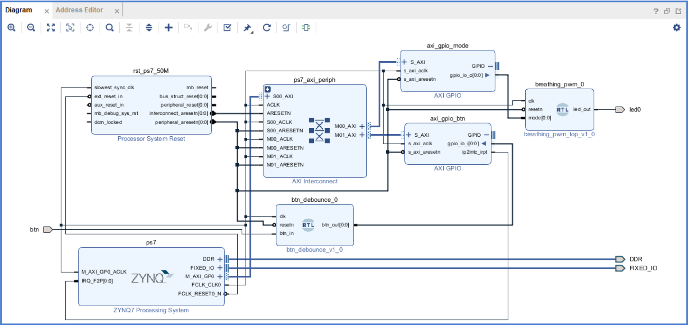
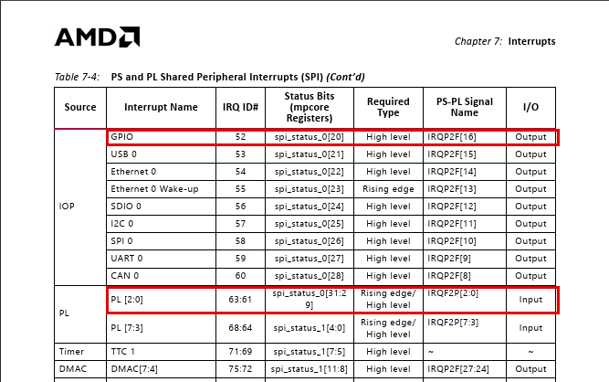
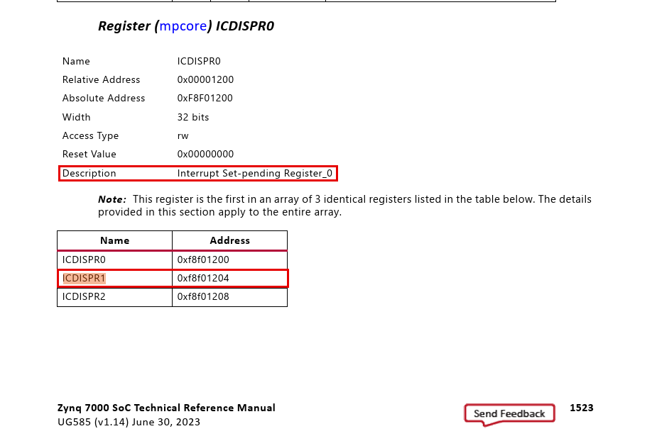
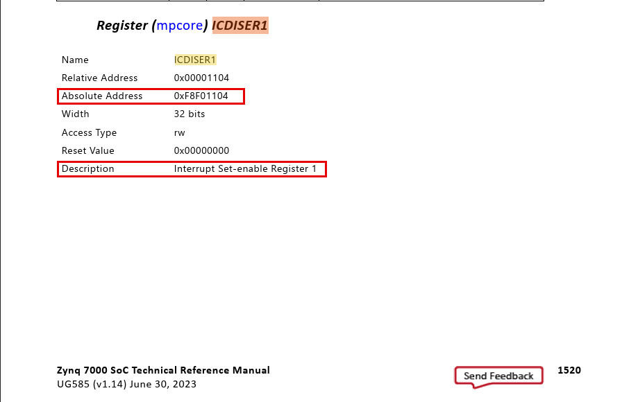
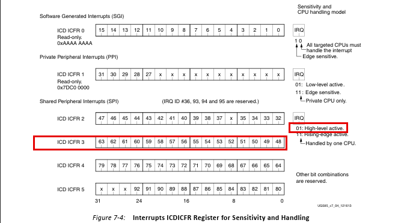
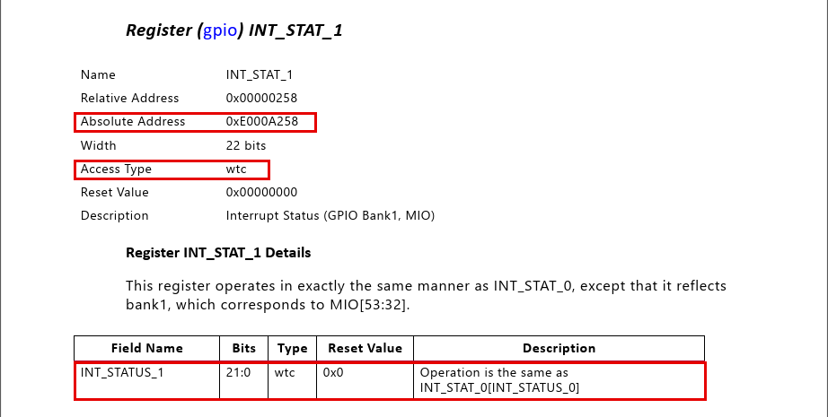
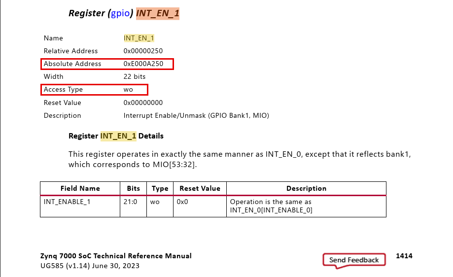
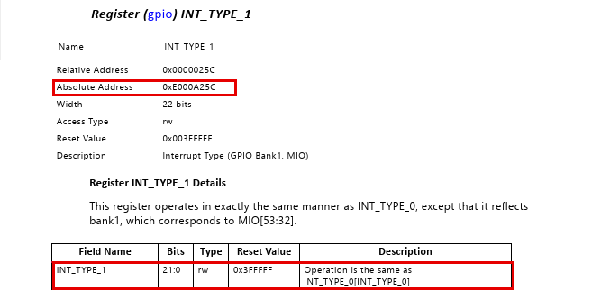
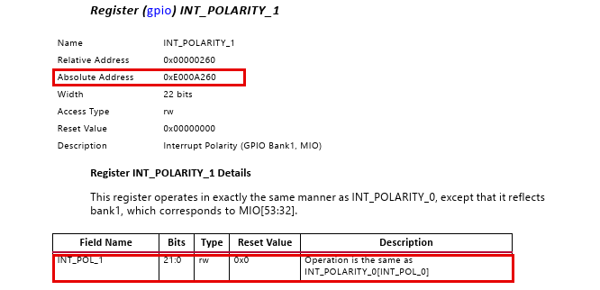
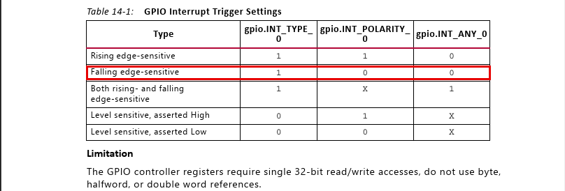

# HW2 — Zynq-7020 中斷與 LED/Push Button 驅動

平台：EGO-XZ7（Zynq-7000, XC7Z020），開發環境 Vivado 2018.2 + Xilinx SDK 2018.2。

## 題目

1. 從 Zynq-7020 的手冊找出跟 BSP（Board Support Package）、ISR 相關的章節。
2. 找出中斷控制器相關的暫存器：**1. IRQ #（port）**、**2. pending register（port status）**、
   **3. mask register（port enable）**。
3. 按下 push button 產生中斷，按鈕訊號**經過 FPGA（PL）**再進中斷控制器；用找到的暫存器寫
   Driver + ISR，讓 LED 有客製化反應。

## 功能規格

- 輸入：**S6（BTNC）**，PL pin **P16**，按下 = 1
- 輸出：**LED0**，PL pin **T22**
- 行為：
  1. 開機預設 LED0 **固定恆亮**。
  2. 按一下 S6 → 切換成**呼吸燈**，週期 T = 2 秒（1 秒漸亮 + 1 秒漸暗）。
  3. 再按一下 S6 → 切回**固定恆亮**，之後每按一次就在兩個狀態間切換。

按鍵偵測用**中斷**，不是主迴圈輪詢（polling）；ISR 與中斷設定都直接讀寫暫存器。

## Demo

[`demo/`](demo/) 資料夾：雙擊 `demo.bat` 就會燒 bitstream → 初始化 PS → 下載 ELF → 執行，
步驟見 [`demo/README.md`](demo/README.md)。

## Vivado Block Design


🔍 [看大圖](https://raw.githubusercontent.com/shj-F115112128/SOC_Practice/master/HW2/Upload/image/block_design.png)
（Vivado Block Design 截圖；可重建腳本：[`vivado/create_bd.tcl`](vivado/create_bd.tcl)）

| 方塊 | 用途 |
|---|---|
| `ps7` | Zynq PS。`M_AXI_GP0` 讓 CPU 存取 PL 的 AXI GPIO；`IRQ_F2P[0:0]` 收 PL 送來的中斷；`FCLK_CLK0` / `FCLK_RESET0_N` 提供 PL 時脈與 reset |
| `ps7_axi_periph` | AXI Interconnect，1 個 master（`S00_AXI`）分給 2 個 slave（`M00_AXI` → `axi_gpio_mode`、`M01_AXI` → `axi_gpio_btn`） |
| `rst_ps7_50M` | Processor System Reset：把 PS 的非同步 reset 同步到 50 MHz 時脈後再分給 PL（見下方說明） |
| `axi_gpio_btn` | 1 bit **輸入**，開 interrupt。`gpio_io_i` 接防彈跳後的按鈕，`ip2intc_irpt` 接 `IRQ_F2P` |
| `axi_gpio_mode` | 1 bit **輸出**。`gpio_io_o` 接 `pwm_breath` 的 `mode` |
| `btn_debounce_0` | 自寫 RTL（[`btn_debounce.v`](vivado/rtl/btn_debounce.v)）：`btn` port → 同步 + 防彈跳 → `btn_out` |
| `pwm_breath_0` | 自寫 RTL（[`pwm_breath.v`](vivado/rtl/pwm_breath.v)）：依 `mode` 輸出恆亮或 2 秒呼吸 PWM 到 `led0` |

`btn` 是單一訊號的輸入 port（不是 GPIO 介面 port），因為按鈕要先經過 `btn_debounce` 才接到
AXI GPIO，不能把 AXI GPIO 的 GPIO 介面直接 Make External。

**為什麼要 `rst_ps7_50M`**：AXI 規格（IHI0022L §A2.1.2）規定 ARESETn「can be asserted
asynchronously, but deassertion can only be synchronous with a rising edge of ACLK」。PS 的
`FCLK_RESET0_N` 由軟體放開、跟 `FCLK_CLK0` 不同步；若拿掉它、把 `FCLK_RESET0_N` 直接
接到各 reset 腳，`validate_bd_design` 會報 8 個 `CRITICAL WARNING [BD 41-1348] ... is connected
to asynchronous reset source /ps7/FCLK_RESET0_N`，所以保留。

## 文件手冊

| 手冊 | 用途 |
|---|---|
| **UG585** Zynq-7000 Technical Reference Manual（v1.14, 2023-06-30）— [線上](https://docs.amd.com/r/en-US/ug585-zynq-7000-SoC-TRM) | GIC 中斷控制器、IRQ ID 表、PS 暫存器位址 |
| **PG144** AXI GPIO LogiCORE IP Product Guide | AXI GPIO 的暫存器（`GPIO_DATA`、`GIER`、`IPISR`、`IPIER`） |
| **EGO-XZ7 User Guide V1.2** | 板子的 LED / 按鈕 / 開關接到哪個 FPGA pin |

暫存器位址要查 Xilinx 原廠的晶片手冊 UG585；EGO-XZ7 User Guide 是板子的硬體手冊
（排針、原理圖、pin 對應表），不含暫存器位址。

> 下文的頁碼是 UG585 PDF 頁碼（跟頁尾印的一樣）。截圖都放在
> [`Upload/image/ug585/`](Upload/image/ug585/)。

## 中斷相關暫存器

按鈕中斷從按下到 CPU 一共經過三層，**每一層都要開**，中斷才會送到 CPU：

```
S6 按下 → btn_debounce → axi_gpio_btn（IPISR / IPIER / GIER）→ IRQ_F2P[0]
        → GIC（ID 61：ICDISPR1 / ICDISER1 bit29）→ CPU（CPSR.I）→ S6IntrHandler
```

| 項目 | PL：`axi_gpio_btn`（基底 `0x41210000`，PG144） | GIC 中斷控制器（UG585） |
|---|---|---|
| **1. IRQ #：port** | GPIO 通道 1 bit0 → `ip2intc_irpt` → `IRQ_F2P[0]` | **IRQ ID 61** — p.238 Table 7-4 |
| **2. pending register：port status** | **`IPISR`** bit0（`0x41210120`） | **`ICDISPR1`** bit29（`0xF8F01204`）— p.1523 |
| **3. mask register：port enable** | **`IPIER`** bit0（`0x41210128`）+ **`GIER`** bit31（`0x4121011C`） | **`ICDISER1`** bit29（`0xF8F01104`）— p.1520 |

GIC 的 `ICD*1` 這組暫存器管 ID 32～63，所以 ID 61 對應 61 − 32 = **bit29**。

### 1. IRQ #：port



> **UG585 p.238 Table 7-4「PS and PL Shared Peripheral Interrupts (SPI)」**
> - 看 **PL 那一列「PL [2:0]」：IRQ ID 63:61**，PS-PL Signal Name = `IRQF2P[2:0]`，I/O = Input。
>   也就是 PL 從 `IRQ_F2P[0]` 送進來的中斷 = **ID 61**（`IRQ_F2P[1]` = 62、`[2]` = 63）。
> - Status Bits = `spi_status_0[31:29]` → ID 61 是 bit29，跟 `ICDISPR1` / `ICDISER1` 的 bit29 一致。
> - Required Type = **Rising edge / High level**（PL 中斷兩種都可以，見下方觸發方式）。
> - 同一張表第一列 GPIO = ID 52 是 **PS 內建 GPIO**（MIO 按鈕 S3/S4 用的，見最後的對照表）。
> - Vivado 匯出的 `xparameters.h` 也產生
>   `#define XPAR_FABRIC_AXI_GPIO_BTN_IP2INTC_IRPT_INTR 61U`，跟手冊一致。

### 2. Pending register：port status

**PL 端 — `axi_gpio_btn` 的 `IPISR`**（IP Interrupt Status Register，offset `0x120`）：
bit0 = 通道 1 的輸入有變化。**toggle-on-write**：對讀到是 1 的 bit 寫 1 才會清成 0
（直接對 0 的 bit 寫 1 反而會把它設成 pending）。

**GIC 端 — `ICDISPR1`**：



> **UG585 p.1523 ICDISPR0（Interrupt Set-pending Register）**
> - 同樣的暫存器有 3 個：`ICDISPR0` 管 ID 0～31、**`ICDISPR1`（`0xF8F01204`）管 ID 32～63**、
>   `ICDISPR2` 管 ID 64～95。本設計用 `ICDISPR1` **bit29**（ID 61）。
> - 讀：1 = 該 ID 正在 pending；寫 1：手動把該 ID 設成 pending。
> - 清除要寫對應的 **`ICDICPR1`（`0xF8F01284`）**，程式在打開中斷前先寫它清掉殘留的 pending。

### 3. Mask register：port enable

**PL 端 — `axi_gpio_btn` 的 `IPIER` + `GIER`**：

| 暫存器 | offset | 寫入值 | 意思 |
|---|---|---|---|
| `IPIER`（IP Interrupt Enable） | `0x128` | bit0 = 1 | 通道 1 的中斷 enable |
| `GIER`（Global Interrupt Enable） | `0x11C` | bit31 = 1 | 整顆 IP 的中斷總開關，關著的話 `ip2intc_irpt` 永遠是 0 |

**GIC 端 — `ICDISER1`**：



> **UG585 p.1520 ICDISER1（Interrupt Set-enable Register 1，`0xF8F01104`）**
> - 管 ID 32～63，寫 1 開啟對應的 ID：本設計寫 **bit29 = 1**（ID 61）。
> - 寫 0 沒有作用；要關閉得寫對應的 **`ICDICER1`（`0xF8F01184`）**。
> - 實機上板後用 debugger 讀到 `ICDISER1 = 0x20000000`（只有 bit29 = 1），確認 ID 61 已開啟。

最後一層是 CPU 本身：CPSR 的 I bit 要清成 0（`Xil_ExceptionEnable()`）才會接受 IRQ。

### 觸發方式



> **UG585 p.240 Figure 7-4「Interrupts ICDICFR Register for Sensitivity and Handling」**
> - 每個 SPI ID 在 `ICDICFR` 佔 2 bit：**`01` = High-level active**、`11` = Rising-edge active。
> - ID 61 在 **`ICDICFR3`**（ID 48～63，`0xF8F01C0C`），位置 (61 − 48) × 2 = **bits[27:26]**。
> - AXI GPIO 的 `ip2intc_irpt` 在 `IPISR` 清掉前會**一直維持 High**，所以設成 **`01`（High level）**。
>   上板讀到 `ICDICFR3 = 0x55555555`，bits[27:26] = `01`。

### 為什麼 ISR 一定要清 `IPISR`

GIC 是 High level 觸發，而 `ip2intc_irpt` 只要 `IPISR` bit0 沒清就一直是 High。ISR 不清的話，
一離開 ISR，GIC 又會看到 pending，ISR 會被無限次反覆觸發。

### 為什麼按一次會中斷兩次

AXI GPIO 是「輸入有變化」就中斷，按下（0→1）、放開（1→0）各一次。ISR 清掉 `IPISR` 後讀
`GPIO_DATA`：是 1（按下）才切換模式，是 0（放開）就不動作。按鍵的機械彈跳已經由 PL 的
`btn_debounce` 濾掉，所以一次按壓剛好只有這兩次中斷。

## 對應到 `main.c`

[`sdk/src/main.c`](sdk/src/main.c) — 中斷設定全部直接讀寫暫存器（`Xil_In32` / `Xil_Out32`）：

| 函式 | 暫存器操作 | 對應項目 |
|---|---|---|
| `SetupModeGpio()` | `axi_gpio_mode` `GPIO_TRI` = 0（輸出）、`GPIO_DATA` = 0（恆亮） | — |
| `SetupBtnGpio()` | `GIER` = 0、`IPIER` = 0（先關）→ `GPIO_TRI` = 1（輸入） | — |
|  | 讀 `IPISR` 再寫回，清掉殘留 | 2. pending |
|  | `IPIER` bit0 = 1、`GIER` bit31 = 1 | 3. mask |
| `SetupInterruptSystem()` | `XScuGic_Connect(ID 61, S6IntrHandler)`：登記 ISR | 1. IRQ # |
|  | `ICDICER1` bit29（先關）→ `ICDICFR3` bits[27:26] = `01` | — |
|  | `ICDIPR`（ID 61 那個 byte）= `0xA0` 優先權、`ICDIPTR` = `0x01` 送給 CPU0 | — |
|  | `ICDICPR1` bit29：清掉殘留的 pending | 2. pending |
|  | `ICDISER1` bit29 = 1 | 3. mask |
|  | `Xil_ExceptionEnable()`：CPSR.I = 0 | — |
| `S6IntrHandler()` | 讀 `IPISR` bit0 → 寫 1 清除 → 讀 `GPIO_DATA`，是 1 才切換 `mode` | 2. pending |
| `main()` | 初始化完主迴圈空轉，所有行為都由中斷驅動 | — |

唯一還用 BSP 的是 CPU 收到 IRQ 後的分派：`XScuGic_InterruptHandler` 讀 `ICCIAR` 取得 ID →
呼叫登記的 ISR → 寫 `ICCEOIR` 結束中斷。

## PL 端 RTL

| 檔案 | 內容 | 驗證 |
|---|---|---|
| [`vivado/rtl/btn_debounce.v`](vivado/rtl/btn_debounce.v) | 2 級同步器 + 防彈跳：輸入要連續 20ms（1,000,000 clk @ 50 MHz）維持同一電位才採用 | [`tb_btn_debounce.v`](vivado/rtl/tb_btn_debounce.v)：模擬按下/放開各彈跳 5 次，輸出只變化 2 次，xsim PASS |
| [`vivado/rtl/pwm_breath.v`](vivado/rtl/pwm_breath.v) | `mode`=0 恆亮；`mode`=1 時 1 kHz PWM、100 階亮度、三角波，每階 10ms → 200 階 = 2 秒 | [`tb_pwm_breath.v`](vivado/rtl/tb_pwm_breath.v)：縮小參數逐階核對亮燈 clk 數，xsim PASS |

## 板上可用的輸入/輸出（EGO-XZ7 User Guide V1.2, §2.9）

| 訊號 | 接到哪裡 | FPGA Pin |
|---|---|---|
| S3 | PS MIO_50（PS 專用腳，不經過 PL） | D13 |
| S4 | PS MIO_51（同上） | C10 |
| S5 (BTNU) | PL fabric I/O | T18 |
| **S6 (BTNC)** | **PL fabric I/O ← 本設計使用** | **P16** |
| S7 (BTNL) | PL fabric I/O | N15 |
| S8 (BTNR) | PL fabric I/O | R18 |
| S9 (BTND) | PL fabric I/O | R16 |
| **LED0** | **PL fabric I/O ← 本設計使用** | **T22** |

按鈕要經過 FPGA，所以只能用 S5～S9 這 5 顆 PL 按鈕；S3/S4 接在 PS 專用的 MIO 腳，
訊號直接進 PS 內建的 GPIO 控制器，不可能繞進 PL。腳位約束：
[`vivado/constraints/hw2.xdc`](vivado/constraints/hw2.xdc)（`btn` → P16、`led0` → T22，皆 LVCMOS33）。

## 建置

```
cd vivado
vivado -mode batch -source create_bd.tcl -tclargs ./build/plbtn   # 建專案 + block design
# 之後在 Vivado：Generate Bitstream → Export Hardware（含 bitstream）
# SDK / hsi：用匯出的 HDF 產生 standalone BSP，再編譯 sdk/src/main.c
```

`vivado/build/` 已經 gitignore；上板用的成品另外複製一份在 [`demo/`](demo/)。
改完 `main.c` 後雙擊 `demo/build_elf.bat` 就能重新編譯。

## 對照：PS 內建 GPIO（MIO 按鈕）的中斷暫存器

板上的 S3/S4 接在 PS 專用的 MIO 腳，中斷走 PS 內建的 GPIO 控制器（IRQ ID 52），不經過 PL。
下表對照它和本設計 AXI GPIO 的三項暫存器，角色一一對應：

| 項目 | PS GPIO（S4 = MIO_51 → Bank1 bit19） | PL AXI GPIO（本設計） |
|---|---|---|
| 1. IRQ # | IRQ ID **52**（Table 7-4 GPIO 列） | IRQ ID **61**（`IRQ_F2P[0]`） |
| 2. pending | `INT_STAT_1` bit19（`0xE000A258`） | `IPISR` bit0 |
| 3. mask | `INT_EN_1` bit19（`0xE000A250`） | `IPIER` bit0 + `GIER` bit31 |
| 觸發方式 | `INT_TYPE_1` / `INT_POLARITY_1` / `INT_ANY_1` | 固定為輸入有變化就中斷 |



> **UG585 p.1415 INT_STAT_1**（`0xE000A258`）— PS GPIO Bank1（MIO[53:32]）的中斷狀態，
> Access Type = **wtc**（write-to-clear，寫 1 清除）。MIO_51 → bit19（51 − 32）。
> 角色等同 AXI GPIO 的 `IPISR`。



> **UG585 p.1414 INT_EN_1**（`0xE000A250`）— PS GPIO Bank1 的中斷 Enable/Unmask，write-only，
> 寫 1 開啟對應 bit。關閉用 `INT_DIS_1`（`0xE000A254`）。角色等同 AXI GPIO 的 `IPIER`。



> **UG585 p.1415 INT_TYPE_1**（`0xE000A25C`）— 1 = edge、0 = level。



> **UG585 p.1416 INT_POLARITY_1**（`0xE000A260`）— 0 = falling/low、1 = rising/high。



> **UG585 p.415 Table 14-1「GPIO Interrupt Trigger Settings」**— `INT_TYPE` / `INT_POLARITY` /
> `INT_ANY` 的組合，例如 MIO 按鈕按下為 low 時用 **Falling edge-sensitive = 1 / 0 / 0**。
> 下方 Limitation：GPIO 控制器暫存器只能用 32-bit 存取。

## 驗證結果

- PL RTL：`tb_btn_debounce`、`tb_pwm_breath` 在 xsim 皆 PASS。
- Vivado：bitstream timing met、0 critical warning；`xparameters.h` 的
  `XPAR_FABRIC_AXI_GPIO_BTN_IP2INTC_IRPT_INTR` = 61，與 UG585 Table 7-4 一致。
- 上板：燒錄 + 執行成功，debugger 讀到 CPU 停在 `main()` 主迴圈、`ICDISER1` = `0x20000000`
  （bit29 = 1）、`ICDICFR3` bits[27:26] = `01`、CPSR.I = 0。
