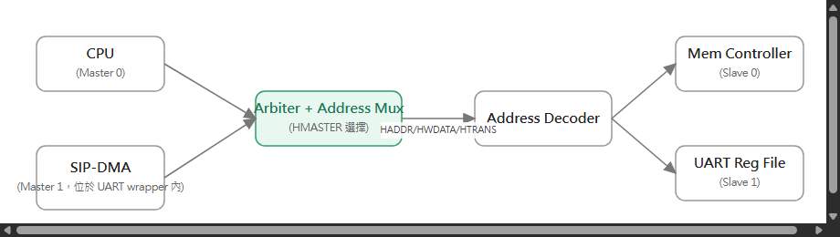
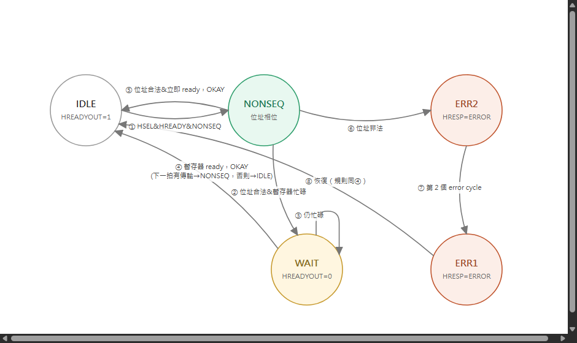
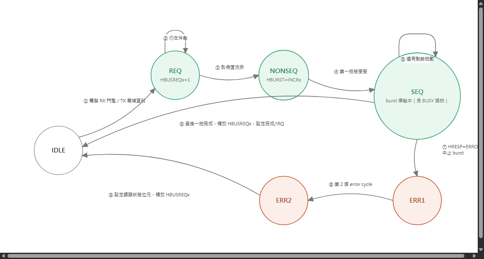
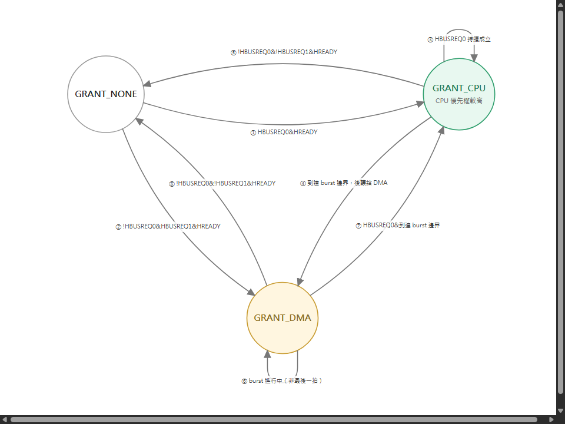

# AHB Master / Slave Wrapper FSM — UART SIP

選用的 IP（SIP）：一顆 UART core（暫存器配置比照EGO-XZ7 板子、Zynq-7000 PS 上常見的
UART ，內建 FIFO），把它包裝成掛在 AHB 匯流排上的模組。這顆 UART 有：

- 一組 **暫存器檔**（control、status、baud divisor、TX data、RX data）→ 以 **AHB slave** 的身份被存取。
- 內部的 **DMA 引擎**，負責把收到的 byte burst 寫回記憶體、以及把要傳送的 byte 從記憶體讀出，
  全程不需要 CPU 介入 → 當它取得匯流排控制權時，扮演 **AHB master**。

因為系統裡有多個 Master（CPU + UART 的 DMA）與多個 Slave（至少有記憶體控制器 + UART 暫存器
slave），中間需要一個 **arbiter（仲裁器）** 與 **address decoder（位址解碼器）**，這是 AHB
規格書裡多層/共享匯流排拓樸的標準做法。

<!--
## 系統拓樸

🔍 [看大圖](https://raw.githubusercontent.com/shj-F115112128/SOC_Practice/main/Upload/image/ahb_topology.drawio.png) ／
原始檔：[Upload/ahb_topology.drawio](../Upload/ahb_topology.drawio)
-->

## 1. AHB Slave Wrapper FSM（UART 暫存器檔）

負責控制 `HREADYOUT`/`HRESP`，並把 UART 的 control/status/TX/RX 暫存器開放給外部存取。狀態命名
沿用上課教的 AHB Subordinate FSM 命名：位址階段是 `NONSEQ`/`SEQ`，資料階段若暫存器還沒 ready
（例如讀取時 RX FIFO 是空的、或寫入時 TX FIFO 滿了）就插入 `WAIT`，非法存取則回應兩個 cycle 的
`ERROR`。

🔍 [看大圖](https://raw.githubusercontent.com/shj-F115112128/SOC_Practice/main/Upload/image/ahb_slave_fsm.drawio.png) ／
原始檔：[Upload/ahb_slave_fsm.drawio](../Upload/ahb_slave_fsm.drawio)

## 2. AHB Master Wrapper FSM（UART 內部 DMA）

由 UART 的 FIFO 門檻值觸發（RX 半滿 → burst 寫入記憶體；TX 低於門檻 → burst 從記憶體讀取）。
在驅動任何位址階段之前，必須先向 arbiter 要求匯流排。

🔍 [看大圖](https://raw.githubusercontent.com/shj-F115112128/SOC_Practice/main/Upload/image/ahb_master_fsm.drawio.png) ／
原始檔：[Upload/ahb_master_fsm.drawio](../Upload/ahb_master_fsm.drawio)（SEQ 狀態的自迴圈已把
「FIFO 未 ready 時插入 BUSY 拍」併進去，不另外畫成一個狀態）

## 3. Arbiter FSM（支援多 Master）

最簡單的固定優先權 arbiter（CPU > DMA）；round-robin 可直接替換。依照 AHB 規則，grant 只能在
傳輸邊界切換（`HREADY=1` 且不在 `SEQ` burst 中途，也就是 `HBURST`/`HTRANS` 顯示最後一拍，或該
master 自行解除請求）。

🔍 [看大圖](https://raw.githubusercontent.com/shj-F115112128/SOC_Practice/main/Upload/image/ahb_arbiter_fsm.drawio.png) ／
原始檔：[Upload/ahb_arbiter_fsm.drawio](../Upload/ahb_arbiter_fsm.drawio)

## 多 Slave 補充說明

Decoder 會把 `HADDR` 範圍對應到各個 `HSELx`；每顆 SIP 真正不同的只有上面這個模組（UART slave
wrapper）— 記憶體控制器 slave、以及 decoder/mux-back 邏輯都是標準 AHB 基礎架構，這裡就不重複
畫出。
