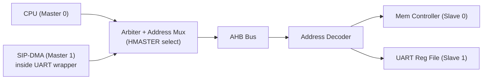
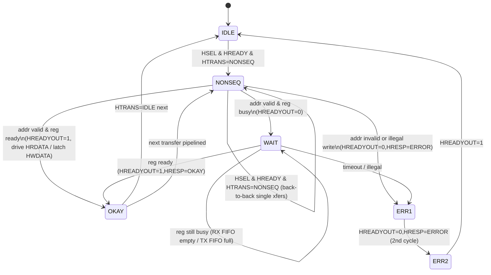
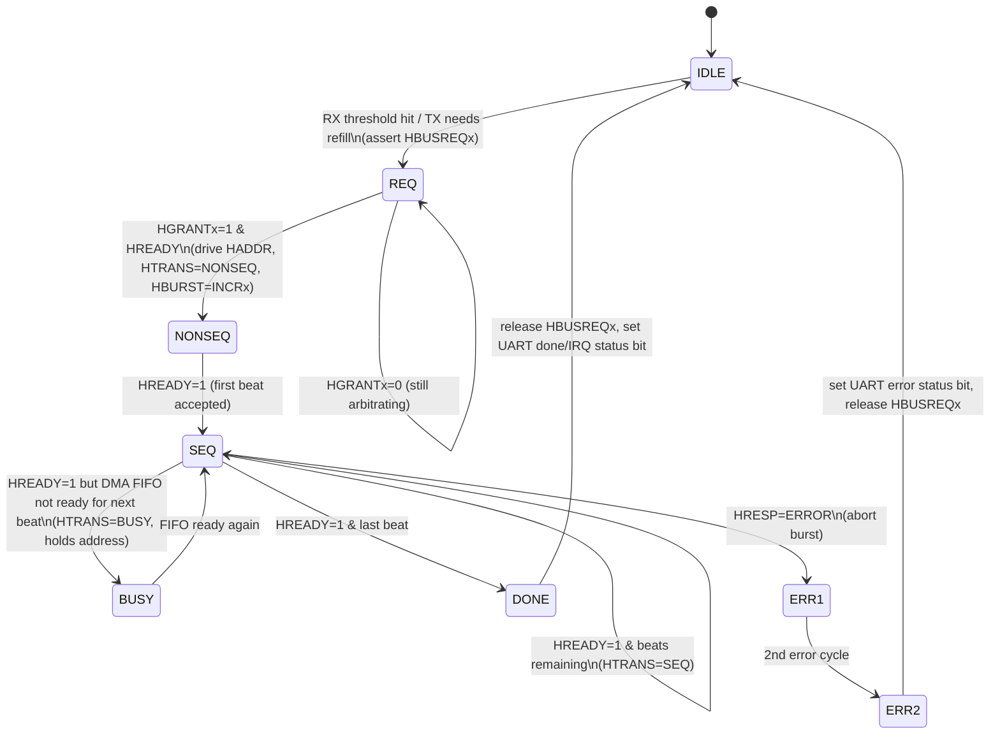
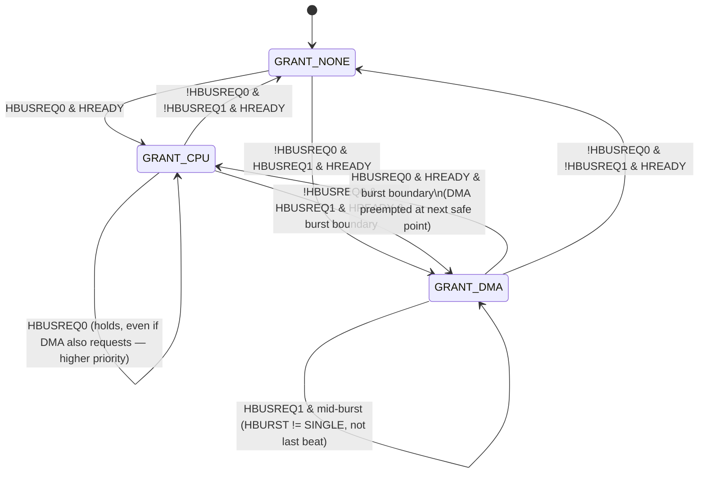

# AHB Master / Slave Wrapper FSM — UART SIP

Selected IP (SIP): a UART core (e.g. [opencores.org `uart16550`](https://opencores.org/projects/uart16550) /
similar FIFO-based UART), wrapped to sit on an AHB bus. The UART has:

- A **register file** (control, status, baud divisor, TX data, RX data) → accessed as an **AHB slave**.
- An internal **DMA engine** that bursts received bytes out to memory, and fetches bytes to transmit,
  without CPU intervention → acts as an **AHB master** when it owns the bus.

Because the system has multiple masters (CPU + the UART's DMA) and multiple slaves (memory controller +
UART register slave, at minimum), a central **arbiter** and **address decoder** sit between them, per the
AHB spec's multi-layer/shared-bus topology.

## System topology

## 1. AHB Slave Wrapper FSM (UART register file)

Controls `HREADYOUT`/`HRESP` while exposing the UART's control/status/TX/RX registers. State names follow
the same convention used for the generic AHB Subordinate FSM (see `project-ahb-fsm-design`): address phase
is `NONSEQ`/`SEQ`, data phase inserts `WAIT` while the register isn't ready (e.g. RX FIFO empty on a read,
or TX FIFO full on a write), and bad accesses get a two-cycle `ERROR`.

## 2. AHB Master Wrapper FSM (UART-internal DMA)

Triggered by the UART's FIFO thresholds (RX half-full → write burst to memory; TX below threshold → read
burst from memory). Must request the bus from the arbiter before driving any address phase.

## 3. Arbiter FSM (multi-master support)

Minimal fixed-priority arbiter (CPU > DMA); round-robin is a drop-in variant. Per AHB rules, the grant can
only change at a transfer boundary (`HREADY=1` and not mid-`SEQ` burst, i.e. `HBURST`/`HTRANS` indicate the
last beat or master deasserts request).

## Multi-slave note

The decoder maps `HADDR` ranges to `HSELx`; only the module above (the UART slave wrapper) changes per
SIP — the memory controller slave and decoder/mux-back logic are standard AHB infrastructure and are not
redrawn here.
