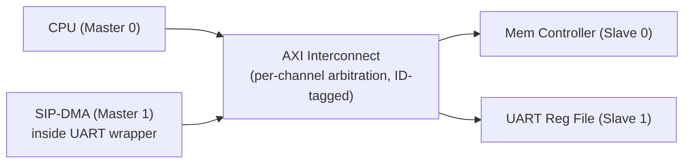
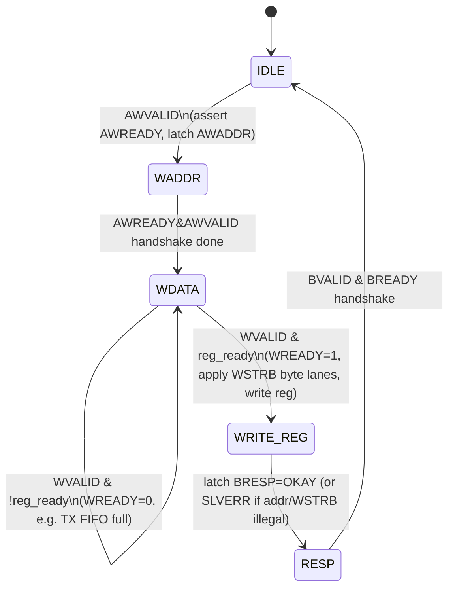
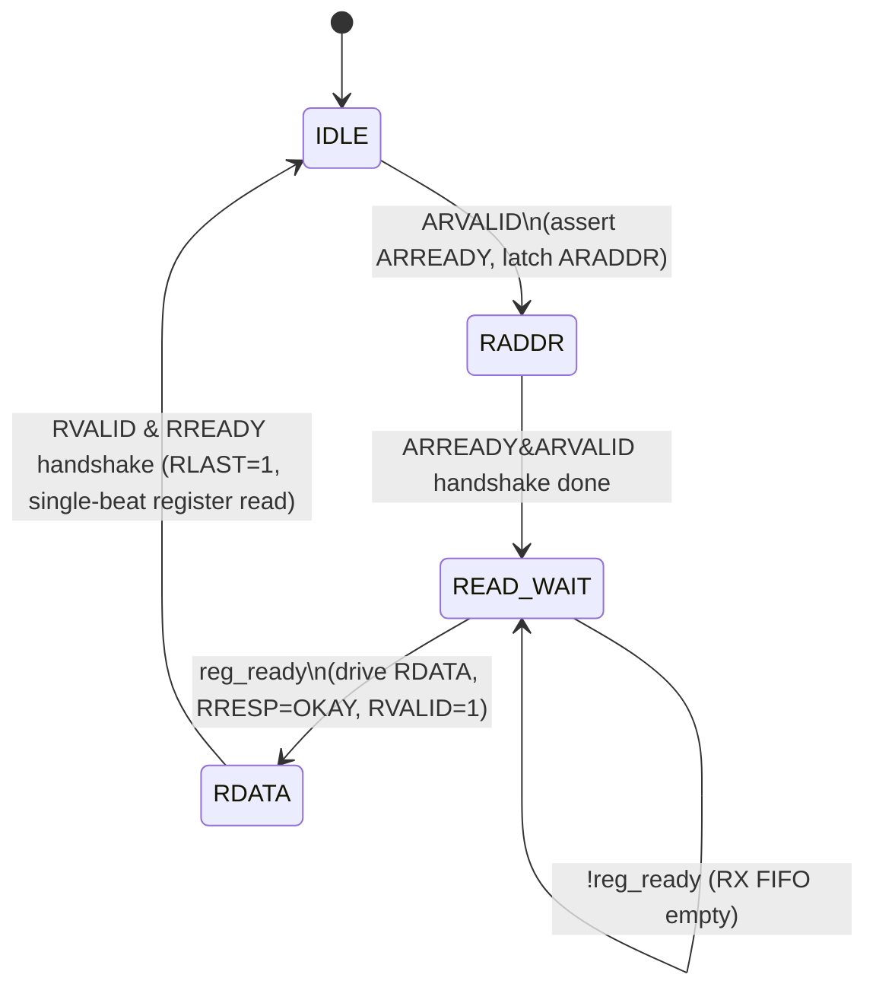

# AXI Master / Slave Wrapper FSM — UART SIP

Same UART SIP as the AHB version (see [01-ahb-wrapper-fsm.md](01-ahb-wrapper-fsm.md)), now wrapped onto
AXI. Unlike AHB's single shared address/data bus, AXI has 5 independent channels (AW, W, B, AR, R), so the
wrapper is naturally split into an independent **write FSM** and **read FSM** on both the master and slave
side — they can run concurrently.

## System topology

## 1. AXI Slave Wrapper FSM (UART register file)

### Write path (AW + W + B)

### Read path (AR + R)

## 2. AXI Master Wrapper FSM (UART-internal DMA)

Write and read DMA paths are independent state machines — the DMA engine can have a read burst (TX
refill) and a write burst (RX flush) outstanding at the same time, something the AHB master wrapper
cannot do.

### Write path (RX FIFO → memory)

```mermaid
stateDiagram-v2
    [*] --> IDLE
    IDLE --> AW: RX threshold hit\n(assert AWVALID, AWADDR, AWLEN=burst-1, AWBURST=INCR)
    AW --> W: AWVALID&AWREADY handshake
    W --> W: WVALID&WREADY & !WLAST (more beats)
    W --> BWAIT: WVALID&WREADY & WLAST
    BWAIT --> IDLE: BVALID&BREADY\n(BRESP=OKAY: clear RX flag; SLVERR: set error status)
```

### Read path (memory → TX FIFO)

```mermaid
stateDiagram-v2
    [*] --> IDLE
    IDLE --> AR: TX FIFO below threshold\n(assert ARVALID, ARADDR, ARLEN=burst-1, ARBURST=INCR)
    AR --> R: ARVALID&ARREADY handshake
    R --> R: RVALID&RREADY & !RLAST (more beats, push into TX FIFO)
    R --> IDLE: RVALID&RREADY & RLAST\n(RRESP checked per beat; SLVERR aborts remaining push)
```

## Multi-master / multi-slave note

AXI has no single central arbiter FSM like AHB's `HGRANT` logic. Each slave's **AW** and **AR** channels
independently arbitrate between requesting masters at the interconnect (ID-tagged so responses route back
to the correct master, and so multiple masters/slaves can have transactions outstanding concurrently). The
slave-side FSMs above are per-slave-port and are reused for the memory controller's AXI slave as well,
just with no register-busy wait states.
