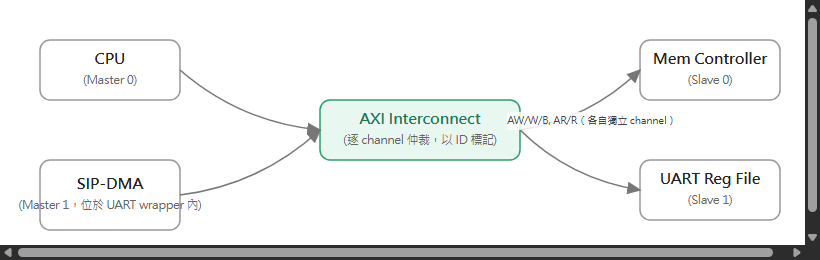
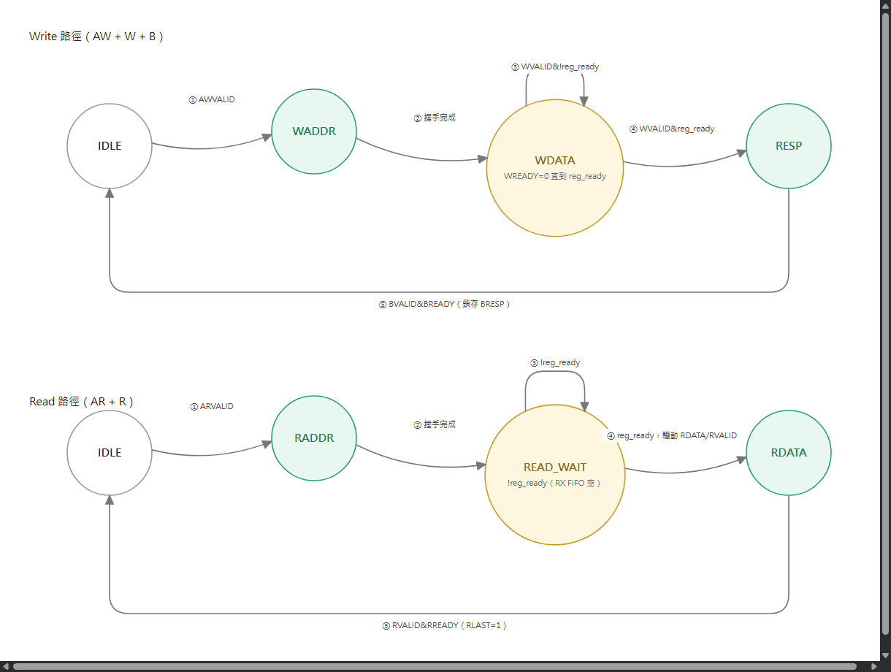
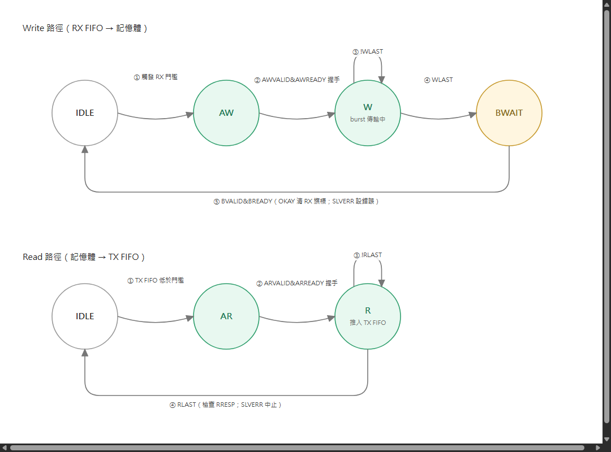

# AXI Master / Slave Wrapper FSM — UART SIP

跟 AHB 版本相同的 UART SIP（見 [01-ahb-wrapper-fsm.md](01-ahb-wrapper-fsm.md)），這次改包裝在
AXI 上。跟 AHB 單一共享的位址/資料匯流排不同，AXI 有 5 個獨立的 channel（AW、W、B、AR、R），
所以 wrapper 自然會拆成 master 端與 slave 端各自獨立的 **write FSM** 和 **read FSM** — 它們可以
並行運作。

<!--
## 系統拓樸

🔍 [看大圖](https://raw.githubusercontent.com/shj-F115112128/SOC_Practice/main/Upload/image/axi_topology.drawio.png) ／
原始檔：[Upload/axi_topology.drawio](../Upload/axi_topology.drawio)
-->

## 1. AXI Slave Wrapper FSM（UART 暫存器檔）

Write 跟 read 兩條 channel FSM 畫在同一張圖裡：

🔍 [看大圖](https://raw.githubusercontent.com/shj-F115112128/SOC_Practice/main/Upload/image/axi_slave_fsm.drawio.png) ／
原始檔：[Upload/axi_slave_fsm.drawio](../Upload/axi_slave_fsm.drawio)（write 路徑的 WVALID
握手跟寫入暫存器併在同一個 `WDATA→RESP` 轉換裡，沒有另外畫一個 `WRITE_REG` 狀態）

## 2. AXI Master Wrapper FSM（UART 內部 DMA）

Write 與 read 兩條 DMA 路徑是各自獨立的狀態機 — DMA 引擎可以同時有一個 read burst（補 TX 資料）
跟一個 write burst（清空 RX）在進行中，這是 AHB master wrapper 做不到的。

write（RX FIFO → 記憶體）跟 read（記憶體 → TX FIFO）兩條 DMA 路徑一樣畫在同一張圖：

🔍 [看大圖](https://raw.githubusercontent.com/shj-F115112128/SOC_Practice/main/Upload/image/axi_master_fsm.drawio.png) ／
原始檔：[Upload/axi_master_fsm.drawio](../Upload/axi_master_fsm.drawio)

## 多 Master / 多 Slave 補充說明

AXI 沒有像 AHB `HGRANT` 那樣單一的中央 arbiter FSM。每個 slave 的 **AW** 與 **AR** channel 會在
interconnect 上各自獨立對提出請求的多個 master 做仲裁（並以 ID 標記，讓回應可以路由回正確的
master，也讓多組 master/slave 交易可以同時 outstanding）。上面這些 slave 端 FSM 是以每個
slave port 為單位，記憶體控制器的 AXI slave 也會重複使用同一套邏輯，只是沒有暫存器忙碌造成的
wait 狀態。
