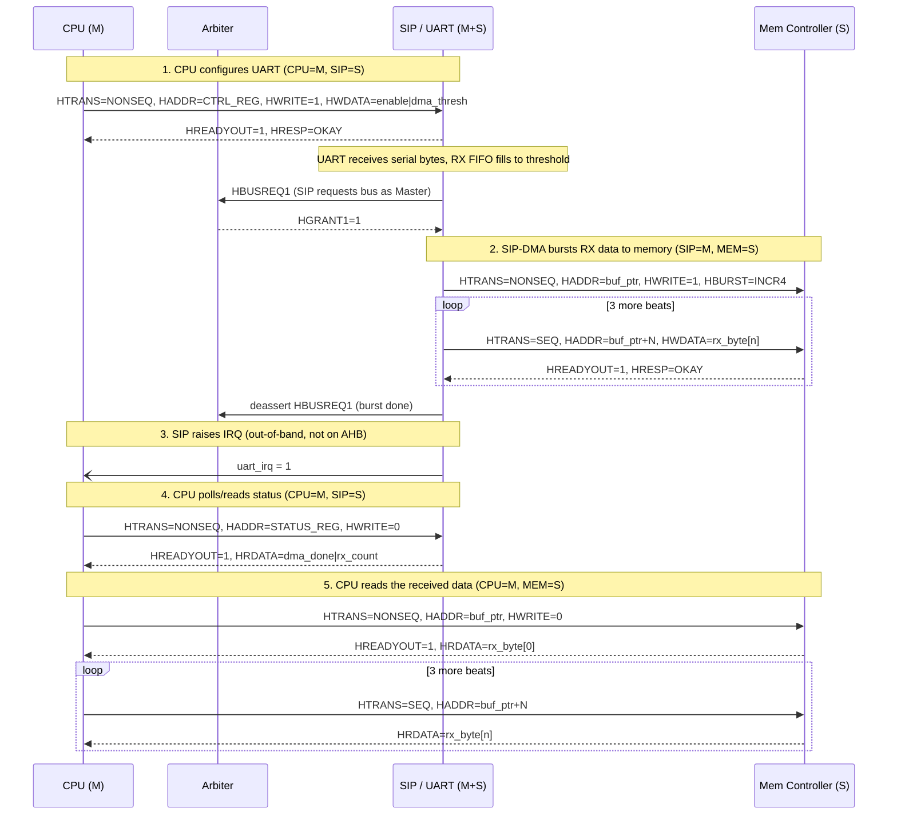

# Message Sequence Chart — AHB

Participants per the assignment: **CPU (Master)**, **Mem Controller (Slave)**, **SIP = UART (Master + Slave,
contains an internal DMA engine)**. Scenario: CPU configures the UART, a full RX word arrives and is
DMA'd to memory, then the CPU reads back the status and data.

## Notes

- Steps 1, 4 and 5 are ordinary single/burst AHB transfers with the CPU as Master; step 2 is the SIP's
  internal DMA acting as Master — only one of CPU/SIP can own the bus at a time (see the arbiter FSM in
  [01-ahb-wrapper-fsm.md](01-ahb-wrapper-fsm.md)), so step 4/5 cannot start until step 2's burst finishes.
- The symmetric TX path (CPU writes bytes to memory, SIP-DMA later bursts them out of memory into the TX
  FIFO, UART serializes them) follows the same shape with the HWRITE direction on the DMA burst flipped to
  a read (SIP=M issuing `HWRITE=0` against the Mem Controller).
