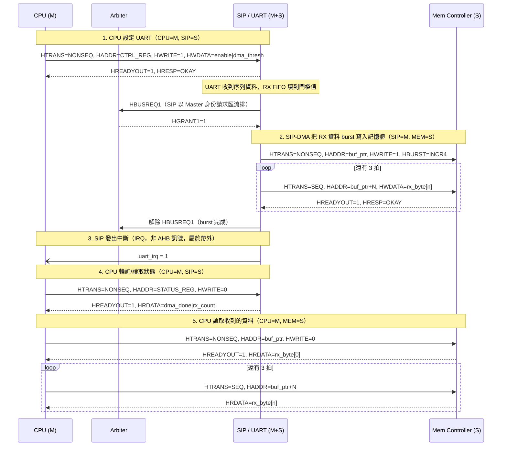

# Message Sequence Chart — AHB

依作業要求的參與者：**CPU (Master)**、**Mem Controller (Slave)**、**SIP = UART (Master + Slave，
內含 DMA 引擎)**。情境：CPU 設定 UART，收到完整一筆 RX 資料後由 DMA 搬到記憶體，最後 CPU 讀回
狀態與資料。

## 補充說明

- 步驟 1、4、5 都是 CPU 以 Master 身份發出的一般單次/burst AHB 傳輸；步驟 2 則是 SIP 內部 DMA
  以 Master 身份動作 — 同一時間只有 CPU 或 SIP 其中一個能擁有匯流排（見
  [01-ahb-wrapper-fsm.md](01-ahb-wrapper-fsm.md) 的 arbiter FSM），所以步驟 4/5 要等步驟 2 的
  burst 結束才能開始。
- 對稱的 TX 路徑（CPU 把資料寫進記憶體，之後 SIP-DMA 再把資料 burst 讀出放進 TX FIFO，UART
  再序列化送出）形狀相同，只是 DMA burst 的 HWRITE 方向改成讀取（SIP=M 對 Mem Controller 發出
  `HWRITE=0`）。
