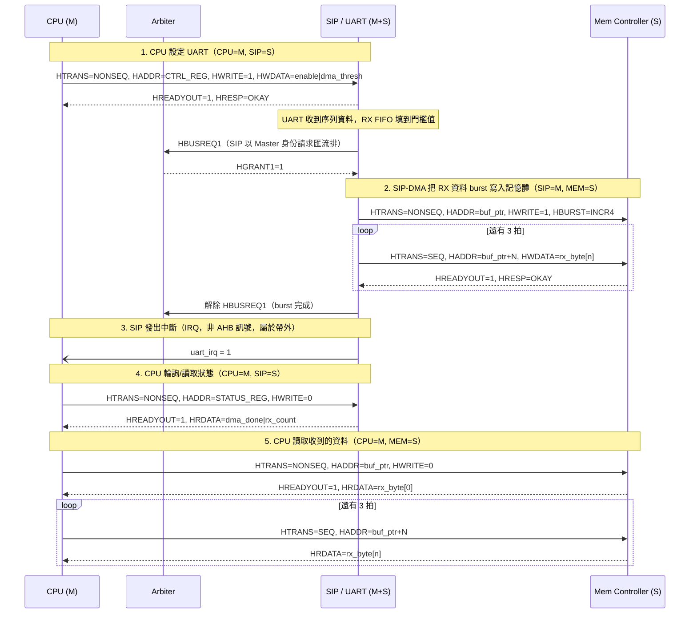

# Message Sequence Chart — AHB

依作業要求的參與者：**CPU (Master)**、**Mem Controller (Slave)**、**SIP = UART (Master + Slave，
內含 DMA 引擎)**。情境：CPU 設定 UART，收到完整一筆 RX 資料後由 DMA 搬到記憶體，最後 CPU 讀回
狀態與資料。

## 補充說明

步驟 2 的時候 SIP 自己變成 master 在搬資料，這時候匯流排是它的，CPU 要等（arbiter 見
[01-ahb-wrapper-fsm.md](01-ahb-wrapper-fsm.md)），所以步驟 4/5 得排在 burst 結束後面。

TX 方向沒有另外畫一張圖，因為形狀幾乎一樣，只是 DMA burst 變成讀記憶體（`HWRITE=0`）再丟進
TX FIFO，其他步驟照搬就好。
