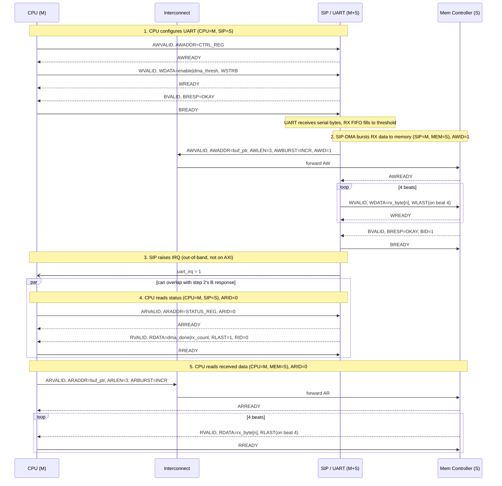

# Message Sequence Chart — AXI

Same scenario and participants as [03-msc-ahb.md](03-msc-ahb.md) — **CPU (M)**, **Mem Controller (S)**,
**SIP = UART (M+S, w/ DMA)** — redrawn over AXI's 5 channels (AW/W/B write, AR/R read). The key behavioral
difference from AHB: write and read channels are independent, so the CPU's status/data read (steps 4–5)
does **not** have to wait for the SIP-DMA's write burst (step 2) to fully retire — both can be outstanding
at once, tagged by `AWID`/`ARID`.

## Notes

- Step 4 is drawn in a `par` block to highlight that it can be issued on the AR/R channel while step 2's
  write burst is still finishing on AW/W/B — not possible on the single shared AHB bus.
- `AWID`/`ARID` tagging lets the Mem Controller and interconnect route responses back to the right master
  even if multiple bursts from CPU and SIP are outstanding simultaneously; see the per-channel FSMs in
  [02-axi-wrapper-fsm.md](02-axi-wrapper-fsm.md).
- The symmetric TX path (CPU writes bytes to memory, SIP-DMA bursts them from memory into the TX FIFO via
  its AR/R master path, UART serializes them out) mirrors step 2 using the SIP's read-DMA FSM instead.
