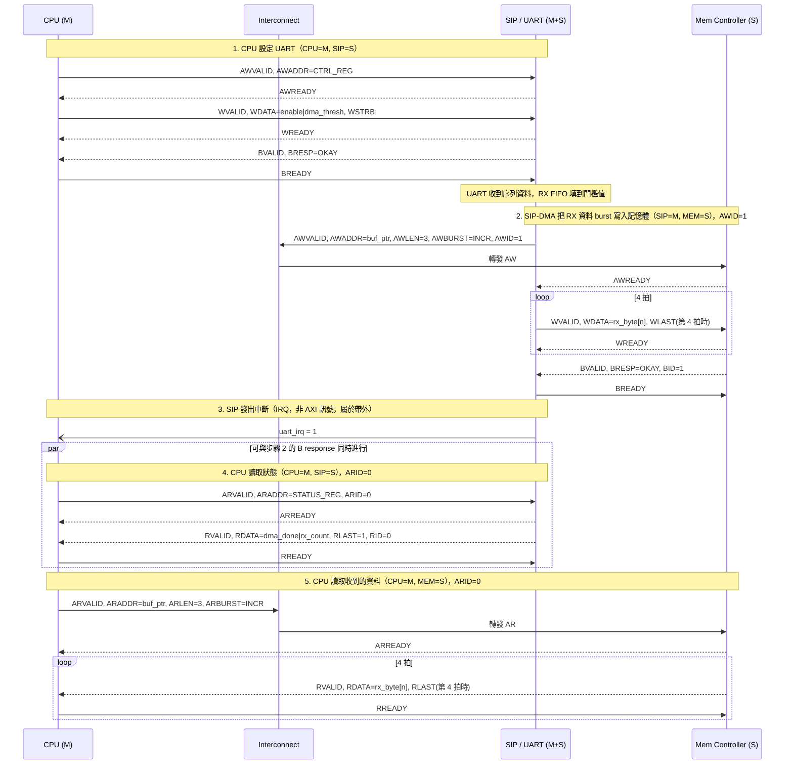

# Message Sequence Chart — AXI

與 [03-msc-ahb.md](03-msc-ahb.md) 相同的情境與參與者 — **CPU (M)**、**Mem Controller (S)**、
**SIP = UART (M+S，含 DMA)** — 改用 AXI 的 5 個 channel（AW/W/B 寫入、AR/R 讀取）重畫。跟 AHB
最大的行為差異：write 與 read channel 彼此獨立，所以 CPU 的狀態/資料讀取（步驟 4–5）**不需要**
等 SIP-DMA 的 write burst（步驟 2）完全結束 — 兩者可以同時 outstanding，靠 `AWID`/`ARID` 標記
區分。

## 補充說明

步驟 4 放進 `par` 區塊是故意的 — 想表示它跑在 AR/R channel，跟步驟 2 的 write burst（還在
AW/W/B 上）其實是同時進行的，AHB 版做不到這件事。

靠的是 `AWID`/`ARID`：Mem Controller 跟 interconnect 用這個 ID 把回應導回正確的 master，所以
CPU 跟 SIP 的交易可以一起 outstanding（細節在 [02-axi-wrapper-fsm.md](02-axi-wrapper-fsm.md)）。

TX 路徑一樣沒另外畫，概念上跟步驟 2 一樣，只是換成 SIP 的 read-DMA FSM 去讀記憶體。
